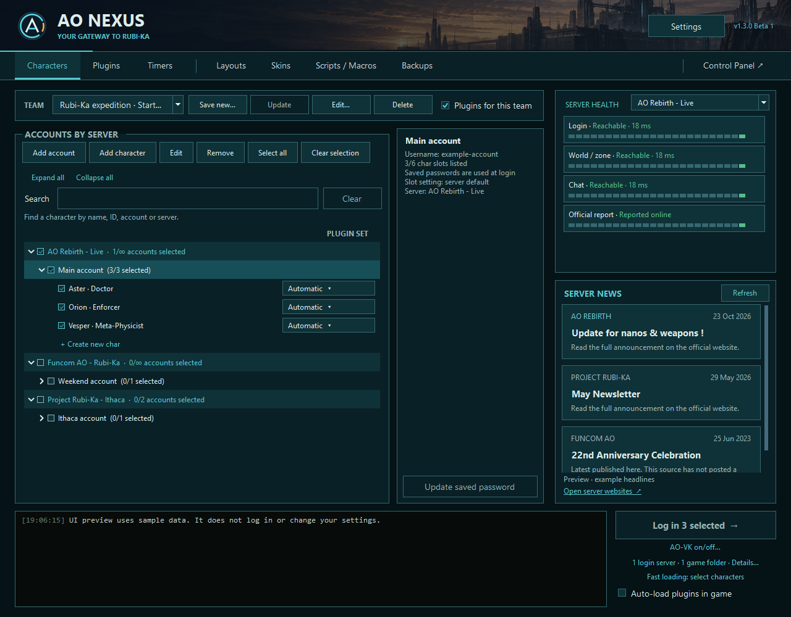

# AO Nexus 1.3.0 Beta

**A Windows launcher and Control Panel for your Anarchy Online accounts, characters and teams.**

Keep separate game folders and login servers, launch a saved team in your chosen order, and compare your characters in one Control Panel.

**[Published downloads](https://github.com/RazRn/AO-Nexus/releases)** · [Player guide](docs/user/Player-Guide.md) · [1.3.0 Beta notes](docs/user/releases/Whats-New-1.3.0.md)

This branch contains **1.3.0 Beta 1**. The Beta label reflects ongoing compatibility and live-game testing. A source update does not publish a new download: check the version on the Releases page. Binary distribution still has outstanding licensing and runtime-validation gates.

*Captured from the Beta with example accounts and offline results. [Screenshot provenance](docs/user/images/SCREENSHOTS.md).*

## Quick start

1. Choose a published release and download **AO-Nexus-Luckyspawn.zip** from its Assets, when available. The automatic Source code archives are for developers.
2. Extract the complete ZIP into a writable folder and start **AONexus.exe**.
3. Add your account, choose its game server and folder, then import characters from Prefs or add their IDs.
4. Select characters and save a team preset. Set its login order; the first character is the initial leader for optional automatic team formation.
5. Choose **Log in selected**. Open **Control Panel ↗** at the right of the navigation bar to monitor the running clients.

Requires Windows 10/11, .NET Framework 4.8 or 4.8.1, and a separately installed compatible game client. [Installation, passwords and download verification](docs/user/Player-Guide.md#install-and-first-launch).

## What is new in the Beta

| Area | What you can do |
| --- | --- |
| [Control Panel](docs/user/Player-Guide.md#control-panel) | View health, nano, attack targets, observed aggro, zones and local client measurements. Select and reorder cards; collapse and reorder Team, Damage Dumper and Timers. |
| [Damage Dumper](docs/user/Player-Guide.md#damage-dumper) | Sort damage, nano damage, individual pets, healing and experience. Compare totals and rates; export clickable in-game report scripts. Optional All and NPC views use nearby observations. |
| [AO# plugins](docs/user/Player-Guide.md#ao-plugins) | Use your own installation, assign profession sets and select shared plugins under ALL. See load status and missing plugins. |
| [Team startup](docs/user/Player-Guide.md#team-presets) | Save login order and keep the first client focused while followers start in the background. Logout/relog pauses formation movement. |
| [Timers](docs/user/Player-Guide.md#timers) | Create manual timers, reminders and optional observed-death timers. A predicted spawn is not a confirmed sighting. |
| [Settings](docs/user/Player-Guide.md#settings-tray-and-updates) | Apply recommended settings as a draft, keep existing opt-ins, and review graphics, diagnostics and experiments separately. |
| [Game GUI](docs/user/Game-GUI.md) | Manage layouts, skins, scripts, character macros and recovery backups. |

English and Danish are supported. Accounts, settings and saved passwords remain local; remembered passwords are encrypted for your Windows user.

## Core and experiments

Normal account/team management, supported fast startup, Control Panel monitoring, Team statistics, manual timers, recovery and diagnostics are core. Measurements and game commands require the relevant Nexus helpers loaded through your own compatible AO# installation.

AO-VK management, automatic invitations/leader recovery, formations, movement refresh, auto regroup and nearby combat reports remain **opt-in experiments**. [Read what each option changes](docs/user/Experiments.md). Minimize inactive game clients is also optional: it can reduce background rendering cost, but previews may freeze and behavior depends on the client/renderer. Recommended settings preserve your choice and do not enable it on a fresh profile.

Nexus does not bundle AO# or third-party plugin packs. The retired AO-VK 0.7.1 download is not offered. No Defender exclusions or disabled protection are required or recommended.

## Known limitations

- A reproduced Engineer startup issue can repeatedly say “You must be standing up to execute a nano program” while the character looks standing. Detection/recovery is not yet reliable; it remains an open Beta issue.
- Minimized windows may stop drawing while health and other telemetry continue. On the tested AO-VK setup, disabling Offscreen surface technology resolved one character's white ICC scene; this is not a universal renderer fix.
- Formations and regrouping require fresh team state. Zoning, obstacles, stale data and unsupported clients can stop automation. Auto regroup is bounded, not obstacle-aware navigation.
- Service graphs measure connection response, not server simulation or backend processing. Aggro is observed targeting, not a server threat list.

See [Beta compatibility and update notes](docs/user/releases/Whats-New-1.3.0.md) for details. New helper code requires a client relog; restarting Nexus alone cannot replace code already loaded into the game.

## Help and development

Use **Settings → Diagnostics → Report a problem…** to prepare an anonymised report. Review it before submitting; nothing is uploaded automatically. [Troubleshooting](docs/user/Player-Guide.md#troubleshooting) · [Privacy and security](docs/user/Privacy-and-Security.md) · [Build and test](docs/development/Building.md) · [Offline guide](dist/README.txt).

User documentation is in [docs/user](docs/user/README.md); implementation notes and test history are in [docs/development](docs/development/README.md).

## Credits and licensing

**Developed and maintained by [Luckyspawn (RazRn)](https://github.com/RazRn).** NexusEngine and LoginHandler retain code derived from [AOQuickLauncher](https://gitlab.com/never-knows-best/aoquicklauncher), by never-knows-best and contributors. The optional monitor uses AOSharp.Common. [Full credits](dist/CREDITS.txt) · [Artwork](assets/ARTWORK.txt).

**Upstream licensing remains unresolved.** Public source/download availability does not grant redistribution rights. See [LICENSE-NOTICE.txt](LICENSE-NOTICE.txt) and [dependency notices](dist/Licenses) before redistributing derived work. Beta branding does not clear these restrictions.

AO Nexus is an independent community project, not an official Funcom, Project Rubi-Ka or AO Rebirth product.
