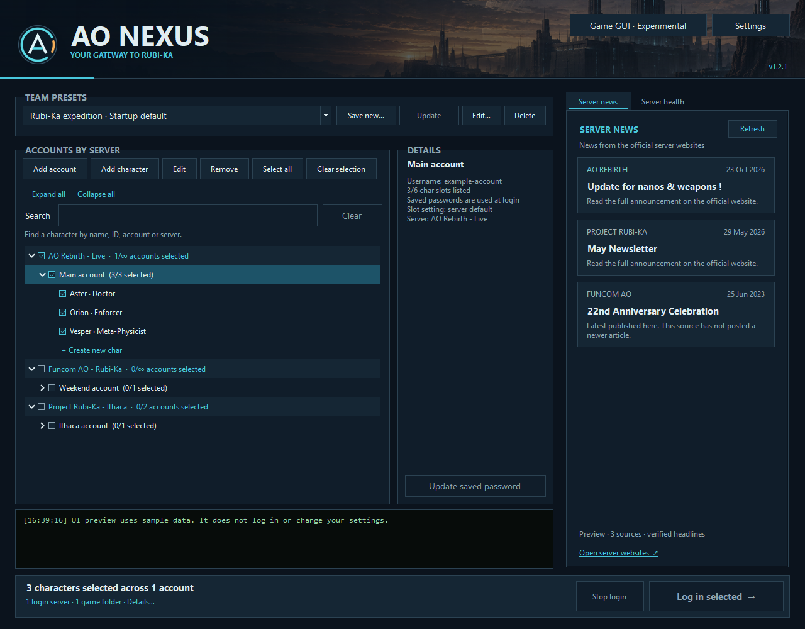

# AO Nexus

**A Windows launcher for your Anarchy Online accounts, characters and teams.**

Keep separate game folders and login servers for Funcom AO, Project Rubi-Ka and AO Rebirth, then launch a saved team from one place.

**[Download the latest release](https://github.com/RazRn/AO-Nexus/releases/latest)** · [Player guide](docs/Player-Guide.md) · [Release notes](https://github.com/RazRn/AO-Nexus/releases)

*AO Nexus 1.2.1 with example accounts and offline news. [Screenshot provenance](docs/images/SCREENSHOTS.md).*

## Quick start

1. Download **AO-Nexus-Luckyspawn.zip** from the latest release's **Assets**. The automatically generated “Source code” ZIP is for developers.
2. Extract the whole ZIP into a writable folder, such as `%LOCALAPPDATA%\Programs\AO Nexus`, and run **AONexus.exe**.
3. Choose **Add account**. Enter your game username; under **Game and server**, select its server and the game folder containing `AnarchyOnline.exe`.
4. Import existing characters with **Find Prefs folders…** and **Find characters**, or save the account and use **Add character** to enter their IDs manually.
5. Check the characters you want and choose **Log in selected**. Review the confirmation if enabled and enter passwords when asked.

Requires Windows 10/11, **.NET Framework 4.8 or 4.8.1**, and an installed game client prepared for the chosen server. See [installation and download verification](docs/Player-Guide.md#install-and-first-launch) for folder, runtime and unsigned-app guidance.

## What you can do

| Feature | How it helps | Guide |
| --- | --- | --- |
| Accounts and team presets | Search by character name, ID, account or server; save teams across accounts; choose an optional startup default. | [Accounts](docs/Player-Guide.md#accounts-and-characters) · [Team presets](docs/Player-Guide.md#team-presets) |
| Launch and logout | Start independent accounts in parallel, with serial logins within each account. Assign team shortcuts for login and normal `/quit`, with separate confirmation preferences. | [Launch, stop and logout](docs/Player-Guide.md#launch-stop-and-logout) |
| Password choices | Remember a password per account, encrypted for your Windows user, or enter it each time. Update or remove saved copies. | [Passwords](docs/Player-Guide.md#passwords) |
| News and server health | Choose news sources and connection checks; optionally monitor in the background and receive tray notifications. | [News and health](docs/Player-Guide.md#server-news-and-health) |
| Tray, updates and logs | Keep Nexus out of Alt+Tab, opt into update checks, and search the activity log. Update installation always requires confirmation. | [Everyday settings](docs/Player-Guide.md#settings-tray-and-updates) |
| Problem reports | Anonymised diagnostics and crash reports, shared as a prefilled GitHub issue only when you choose to. | [Report a problem](docs/Player-Guide.md#report-a-problem) |
| Game GUI · Experimental | Follow clear steps to reuse layouts, select skins, copy script files or character macros, and review backups before restoring. | [Layouts, skins, scripts and recovery](docs/Game-GUI.md) |
| Character status and help | See responsiveness and recent casts while falling separately, with explanations and next steps. Expand measurements or save a diagnostic ZIP. | [Monitoring and reports](docs/Player-Guide.md#character-status-and-monitoring) |

The interface supports English and Danish. It initially follows Windows' language, with a manual override in Settings.

### Faster loading

**Settings → Accounts → Faster game loading** enables the measured startup improvements on the verified classic 18.8.62 client: zero-duration initial logo fades and faster initial texture filtering. With **Skip login screens** enabled, cosmetic login-scene models are skipped too. Login errors remain visible. The setting is on by default and can be disabled independently of quiet login.

Nexus checks the client files before enabling these version-specific hooks. Other builds and character creation retain normal loading. Game executables and DLLs are not patched on disk. Client preparation can overlap while account login claims are serialized; the log shows each character's loading time and total team time. These changes do not remove network latency or the work needed to load a zone.

AO Nexus uses its integrated **NexusEngine** for login and client startup. Moving from the standalone AOQuickLauncher to a Nexus-maintained engine gives us direct control over loading performance, login timing and future improvements. No separate launcher installation is needed. See [integration and validation notes](docs/Fast-Startup.txt) for measured changes and supported clients.

## Scope and privacy

Nexus launches supported Windows AO clients. It does not install or patch the game, include the AOSharp injector, or automatically support replacement clients with a different login protocol. The server controls which logins are allowed; configurable launcher limits help prevent invalid selections. Optional monitoring includes an AOSharp plugin and helper; you choose whether to enable it in your existing AOSharp profiles.

Accounts, settings, saved passwords and GUI templates stay on your PC. The app connects to your chosen game servers, enabled news/health sources, GitHub for requested update checks/downloads, and skin sources when you request a download. Optional client monitoring uses AOSharp's UDP multicast IPC; it can reach the local network. It has no analytics or cloud account sync, and problem reports are only shared when you submit them yourself. Read [Privacy and security](docs/Privacy-and-Security.md) for storage, connections, retention and update verification.

## Need help?

| Problem | Start here |
| --- | --- |
| No characters appear after adding an account | [Find Prefs or add an ID manually](docs/Player-Guide.md#accounts-and-characters). |
| A team does not retain checkbox changes | Select the preset and choose **Update** after changing its members. [Preset behavior](docs/Player-Guide.md#team-presets). |
| A saved game password changed | Select the account and choose **Update saved password** in Details. [Password options](docs/Player-Guide.md#passwords). |
| A game will not launch, update or close as expected | [Troubleshooting](docs/Player-Guide.md#troubleshooting). |
| Something else is broken or Nexus crashed | **Settings → General → Report a problem…** builds an anonymised report and opens a prefilled GitHub issue. [How it works](docs/Player-Guide.md#report-a-problem). |

Reports from Nexus replace logins, account and character names, IDs and personal paths with codes. Nothing is sent until you submit the issue yourself. If you write an issue by hand, leave out passwords, usernames and personal paths.

## More documentation

- [Player guide](docs/Player-Guide.md): setup and everyday use, with focused red callouts.
- [Game GUI](docs/Game-GUI.md): experimental character templates, macros, installation skins, scripts and backups.
- [Server health](docs/Server-Health.md): endpoints, timing and what check results mean.
- [Privacy and security](docs/Privacy-and-Security.md): local data and network behavior.
- [Build and test](docs/Building.md): contributor requirements, commands and source map.
- [Offline quick guide](dist/README.txt): the text guide prepared for download packages.

## Credits and licensing

**AO Nexus is developed and maintained by [Luckyspawn (RazRn)](https://github.com/RazRn).** This includes the launcher interface, account and team management, Game GUI tools, monitoring and NexusEngine integration.

NexusEngine and LoginHandler retain code derived from [AOQuickLauncher](https://gitlab.com/never-knows-best/aoquicklauncher), originally by **never-knows-best and contributors**. The optional monitor uses **AOSharp.Common** from the same authors. See [full third-party credits](dist/CREDITS.txt) and [artwork provenance](assets/ARTWORK.txt).

**Upstream licensing remains unresolved.** Public source and download availability are not grants of redistribution rights. See [LICENSE-NOTICE.txt](LICENSE-NOTICE.txt) before redistributing or publishing derived work. Dependency notices remain in [dist/Licenses](dist/Licenses).

AO Nexus is an independent community project, not an official Funcom, Project Rubi-Ka or AO Rebirth product.
