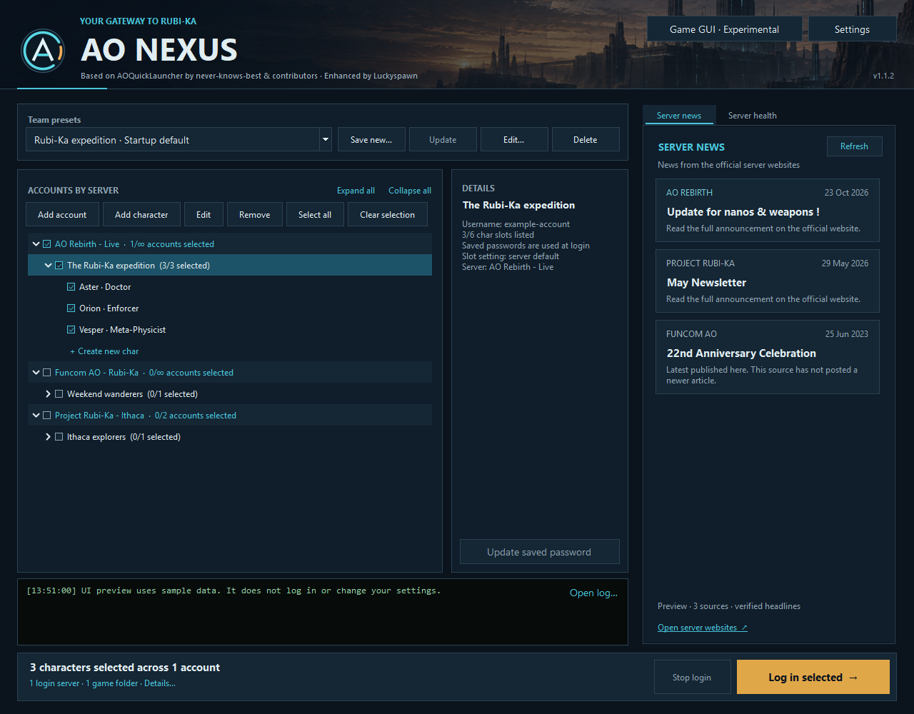
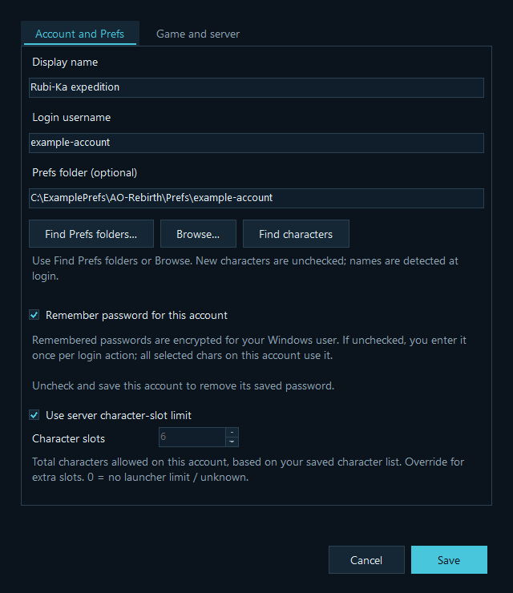
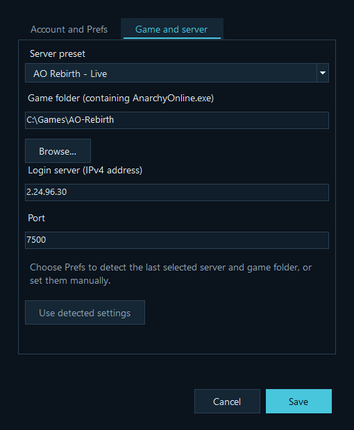
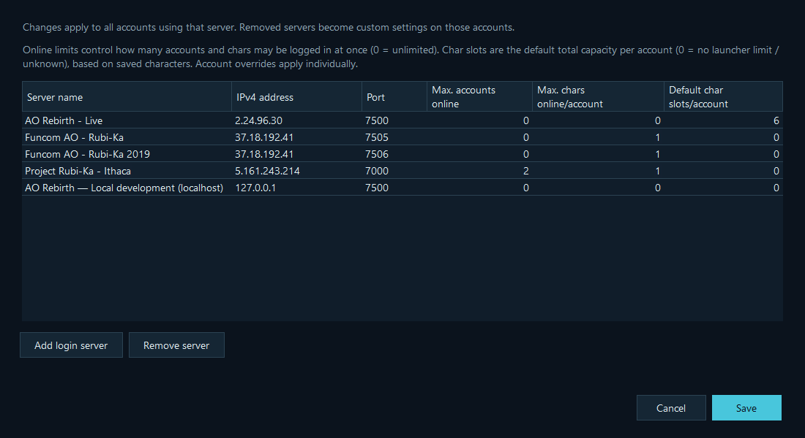
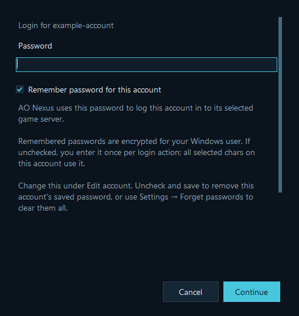
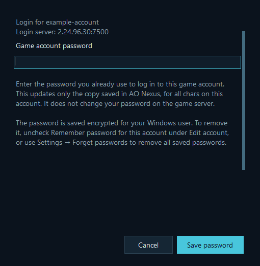

# AO Nexus

**A launcher for your accounts, characters and squads across Anarchy Online servers.**

AO Nexus **v1.0.11** brings separate game installations, login servers, saved character selections and server news into one Windows app. It includes presets for Funcom AO, Project Rubi-Ka and AO Rebirth, and lets you add your own server entries.

Based on [AOQuickLauncher](https://gitlab.com/never-knows-best/aoquicklauncher) by **never-knows-best and contributors**. Customized by **Luckyspawn**.

[Download a release](https://github.com/RazRn/AO-Nexus/releases) · [Source repository](https://github.com/RazRn/AO-Nexus) · [Player guide](dist/README.txt)



Screenshots show the actual v1.0.11 interface with example accounts and offline news fixtures. They contain no personal accounts or passwords.

## What it does

- Groups accounts and characters by server, with collapsible lists and a details panel.
- Saves squads containing characters from any combination of accounts and servers.
- Gives each account its own game folder, server connection and password preference.
- Imports character IDs from existing Prefs folders, or accepts IDs entered manually.
- Starts independent account queues in parallel, while logging in characters on the same account one at a time.
- Checks configurable account, simultaneous-character and character-slot limits before launching.
- Opens character creation and can add a newly created character automatically when it enters the game.
- Saves passwords only when requested, encrypts saved passwords for the Windows user, and lets you update each account separately.
- Shows news from official server websites with a saved choice of sources.
- Supports English and Danish, with an automatic Windows-language default.

AO Nexus launches supported Windows AO clients. It does not install or patch the game, provide AOSharp plugins, or automatically support a replacement client with a different login protocol.

## Contents

- [Install and first launch](#install-and-first-launch)
- [Add accounts and characters](#add-accounts-and-characters)
- [Game folders, servers and limits](#game-folders-servers-and-limits)
- [Choose characters and save squads](#choose-characters-and-save-squads)
- [Start and stop logins](#start-and-stop-logins)
- [Create a new character](#create-a-new-character)
- [Passwords](#passwords)
- [News and language](#news-and-language)
- [Local data, updates and sharing](#local-data-updates-and-sharing)
- [Troubleshooting](#troubleshooting)
- [Build and test](#build-and-test)
- [Source map](#source-map)
- [License and attribution](#license-and-attribution)

## Install and first launch

You need Windows 10 or 11, **.NET Framework 4.8**, and a separate game installation prepared for the server you want to play on. The download includes the login engine and its .NET runtime; players do not need to install the .NET 10 SDK.

1. Download **AO-Nexus-Luckyspawn.zip** from [Releases](https://github.com/RazRn/AO-Nexus/releases).
2. Extract the ZIP into a folder of your choice.
3. Start **AONexus.exe**. You can create a normal Windows shortcut to that file.
4. Choose **Add account**, enter the account details, and select its game installation and server.
5. Import character IDs from Prefs or add a character manually.
6. Check the characters you want, choose **Log in selected**, review the confirmation, and enter any requested passwords.

The executable contains the compressed login engine. You do not need a sibling AOQuickLauncher folder. On first use, the engine is extracted and verified in the local runtime cache.

If the earlier AO Launcher is configured on the same Windows profile, AO Nexus imports its accounts, presets, server catalog and eligible encrypted passwords on first start. It copies that profile without changing the original. Subsequent settings are independent.

## Add accounts and characters

### Add an account

Choose **Add account**. The dialog has two tabs:

| Tab | What to enter |
| --- | --- |
| **Account and Prefs** | A display name, the actual game login username, an optional Prefs folder, password-saving preference and any character-slot override. |
| **Game and server** | A server preset, the game folder containing `AnarchyOnline.exe`, and the login server's IPv4 address and port. |



The account dialog is expanded here to show its scrollable settings. The example path is illustrative; choose your own Prefs folder. This example account has password remembering enabled; new accounts default to leaving it unchecked.

The display name is your label in AO Nexus; it can differ from the login username. No personal game directory is filled in for new accounts. Choose the installation that belongs to this server.

Review both tabs and choose **Save**. To change these values later, select the account row and choose **Edit**.

### Import characters from Prefs

Prefs import is optional. It discovers IDs from local `Char123456` folder names; it does not download a character list from the game server.

1. In **Account and Prefs**, choose **Find Prefs folders…**, or use **Browse…** or paste a complete path.
2. Select the account's own folder under `Prefs`.
3. Use **Find characters** to preview the discovered IDs.
4. Review the suggested game folder and server, then **Save**.

A typical Windows location is:

```text
%LOCALAPPDATA%\Funcom\Anarchy Online\<installation-hash>\<installation-name>\Prefs\<account-name>
```

Paste `%LOCALAPPDATA%\Funcom\Anarchy Online` into File Explorer to start looking. The hash and installation name vary; their appearance alone does not identify the server. Discovery uses available installation metadata, including Windows registration and local installation evidence, to help distinguish candidates.

The importer also accepts an account's `Prefs.xml` file or a `Char123456` subfolder. If you select the parent `Prefs` folder containing several accounts, enter the matching login username or choose the specific account folder instead.

Server and game-folder suggestions are best-effort. The last selected server in an installation's preferences is not proof that every account in that installation belongs there. **Check the Game and server tab before saving.**

Imported characters start **unchecked**. Prefs folder names provide IDs, so you may initially see **Character 123456 (name detected at login)**. The actual name is detected when that character successfully enters the game. You can edit a display name yourself as well.

### Add a character without Prefs

You can leave **Prefs folder (optional)** empty, save the account, select it and choose **Add character**.

1. Log into that character normally in the game.
2. Press **Shift+F9** and find its character ID.
3. For an ID shown as `50000:123456789`, enter **123456789** in AO Nexus.
4. Optionally enter a display name, then choose **Save**.

The number is used to log in; the display name is not a substitute for the ID. Double-click a character or select it and choose **Edit** to correct its entry. **Remove** removes the selected entry from AO Nexus, not the character from the game server.

## Game folders, servers and limits

Each account has its own installation and connection settings under **Edit → Game and server**. Different accounts can use different installations, and accounts targeting the same server can share an appropriate installation.



If a selected installation has moved or no longer contains `AnarchyOnline.exe`, AO Nexus asks you to choose the correct folder before proceeding. If the game was removed, cancel, reinstall the correct client, and choose its new folder.

### Manage the server catalog

Open **Settings → Manage login servers…** to rename servers, edit their address and port, change limits, or choose **Add login server**. Changes apply to accounts using that preset. Removing a preset leaves affected accounts with their existing connection as custom settings.



These are the defaults in the **v1.0.11 source**, rather than a live statement of each server's current rules or availability. Existing profiles can retain their saved values.

| Server preset | Login address | Max. accounts | Chars per account | Character slots |
| --- | --- | ---: | ---: | ---: |
| AO Rebirth - Live | `2.24.96.30:7500` | 0 | 0 | 6 |
| Funcom AO - Rubi-Ka | `37.18.192.41:7505` | 0 | 1 | 0 |
| Funcom AO - Rubi-Ka 2019 | `37.18.192.41:7506` | 0 | 1 | 0 |
| Project Rubi-Ka - Ithaca | `5.161.243.214:7000` | 2 | 1 | 0 |
| AO Rebirth — Local development (localhost) | `127.0.0.1:7500` | 0 | 0 | 0 |

The localhost entry is for a server running on your own computer. It is not a second public AO Rebirth server.

### The three limits mean different things

| Setting | Meaning of a positive number | Meaning of 0 |
| --- | --- | --- |
| **Max. accounts** | Maximum simultaneous login accounts on this server. | No launcher account limit. |
| **Chars per account** | Maximum simultaneous characters using one login account. | No launcher simultaneous-character limit. |
| **Character slots** | Total characters allowed on an account, based on the characters known to AO Nexus. Controls whether **Create new char** is offered. | No known launcher capacity limit; the server still decides. |

For example, a server can permit six stored characters but only one of them online at once. The number next to a server group refers to selected accounts and the simultaneous-account limit; it is not a character-slot counter.

Accounts normally inherit the server's character-slot value. To represent extra or different slots on one account, open **Edit**, uncheck **Use server character-slot limit**, and enter its **Character slots** value.

The launcher also accounts for tracked game clients that are already running. The two Funcom dimensions share the per-login-account character restriction. Duplicate launcher entries do not provide additional capacity for the same login.

These values are checks in AO Nexus. Changing them does not grant extra slots, alter server rules or make a server accept additional sessions. Keep them consistent with the server's current rules.

## Choose characters and save squads

The main list is grouped as **server → account → character**. Use the chevrons to collapse groups, or **Expand all** and **Collapse all**. Checking an account or server selects its child characters; **Select all** and **Clear selection** apply to the whole list.

To save a setup:

1. Check the characters you want, across any accounts or servers.
2. Under **YOUR SQUADS**, choose **Save new…** and give the setup a name.
3. Later, choose that setup in the picker to restore its selection.
4. Review the selected characters and choose **Log in selected** when ready.

Selecting a squad changes checkboxes; it does not immediately start games. If you change the checkboxes afterwards, the status shows **Modified**. Choose **Update** to save that selection into the current squad, or **Save new…** to keep it separately. **Rename…** and **Delete** manage the saved squad itself.

A squad stores character references, not a second copy of the account settings. Account changes still apply. Missing characters are reported and skipped; newly imported or created characters do not silently join existing squads.

## Start and stop logins

**Log in selected** shows a confirmation with the number of accounts, login servers and characters selected. Review it before continuing. The account's current password preference determines whether a password prompt is needed.

- **Separate login accounts:** their queues can run in parallel.
- **Multiple characters on one account and server:** they log in serially. The next waits for the previous character to be detected in game.
- **Already-open characters:** recognized existing clients are skipped rather than started again.
- **An account fails:** its remaining queue stops; independent account queues can continue.

Serial login does not mean the first character closes when the next starts. Successfully opened game windows remain open, subject to server limits. Creating duplicate account entries or using separate game folders does not make the same login run in parallel.

**Stop login** stops further launcher activity for that login action. Game windows already started remain open. You can also close AO Nexus after login; it does not close your game windows.

## Create a new character

**Create new char** appears beneath an account while its configured capacity permits. This is different from **Add character**, which records an existing character ID.

1. Select the account's **Create new char** row and use the matching button in **DETAILS**, or double-click the row.
2. Enter a password if prompted and let AO Nexus open the game in character creation.
3. Complete character creation in the game itself.
4. Keep AO Nexus open until the character enters the world.

AO Nexus monitors that launched client for up to one hour. When it detects the new ID and name, it adds the character under the correct account, **unchecked**. Prefs are not required for this detection, and existing squads are unchanged. The rest of the launcher remains usable while creation is open.

Closing AO Nexus ends this detection but leaves the game window open. If detection ends or the client does not support it, import the character from Prefs or add its ID manually. The capacity check only knows characters already recorded in the launcher; the server remains the authority on whether another can be created.

## Passwords

### Ask each time or remember per account

**Remember password for this account** appears in the account editor and the password prompt.

| Choice | Behavior |
| --- | --- |
| Unchecked | Prompt once for that account per login or character-creation action. Reuse that entry for its selected characters during the action, without saving it for future actions. |
| Checked | Save the password encrypted for the current Windows user and use it for future logins. |

New accounts default to asking each time. Existing profiles retain their previous remembering preference. You can mix remembered and non-remembered accounts in the same squad.



### Update one saved password

After changing the password with the game server:

1. Select the **account row** in AO Nexus.
2. Choose **Update saved password** in **DETAILS**.
3. Enter **New password** and **Confirm new password**.
4. Choose **Save password**.



This replaces only that account's encrypted copy in AO Nexus, for all its characters. It does not change the game-server password or log the account in. Saving here enables remembering for that account; other accounts are unaffected. Cancel leaves the saved password unchanged.

### Remove saved passwords

For one account, open **Edit**, uncheck **Remember password for this account**, and **Save**. Its old saved password is removed.

For all AO Nexus accounts, use **Settings → Forget passwords**. This clears saved passwords immediately while keeping accounts and squads. Remembering preferences remain, so the next password prompt can save a new value if its checkbox is still checked.

Saved passwords use Windows data protection for the current Windows user. They are not stored in the account-settings JSON. A copied credential file is not intended as a portable password export; expect to enter passwords again when moving to another Windows account or computer.

## News and language

The **TRANSMISSIONS** panel reads Funcom AO, Project Rubi-Ka and AO Rebirth's official news sources. Use its source picker to check any combination of publishers. The selection saves automatically, including an empty selection.

Use **Refresh** to fetch again; news also refreshes when the app opens and every 15 minutes while the panel is open. Clicking a headline opens the original article in your default browser. **Open server websites** opens a publisher's website.

Article publication dates and the last refresh time are different: refreshing an old announcement does not make it new. If a source is unavailable or changes format, cached news remains readable. News is not a server-status monitor, and unavailable news does not prevent login. Custom and local servers do not automatically gain their own news feeds. See [NEWS-SOURCES.md](NEWS-SOURCES.md) for the implemented sources and cache behavior.

Under **Settings → Language**, choose **Automatic (system language)**, **Dansk** or **English**. Automatic uses Danish for a Danish Windows UI language and English otherwise. New log messages use the chosen language; messages already written are not translated retroactively.

## Local data, updates and sharing

The executable can live in a folder of your choice, but profile data is stored per Windows user rather than next to it.

| Path | Purpose |
| --- | --- |
| `%LOCALAPPDATA%\AONexus\AONexus.json` | Accounts, character selections, squads, server settings, language and news choices. |
| `%LOCALAPPDATA%\AONexus\Credentials` | Windows-encrypted saved passwords. |
| `%LOCALAPPDATA%\AONexus\News` | Cached news. |
| `%LOCALAPPDATA%\AONexus\Runtime` | Verified extracted copies of the embedded login engine. |
| `%LOCALAPPDATA%\AOQuickLauncher` | The older launcher's profile and shared login-session coordination. AO Nexus does not replace the older profile. |

Moving the EXE on the same Windows profile does not create a separate set of accounts. For a backup, close AO Nexus and copy its local profile to a private location. Treat that backup as personal data, even though passwords are encrypted.

To update, close AO Nexus, extract the newer release into your application folder, then start **AONexus.exe** again. Your separate local profile remains available. The app version appears in the header. Game windows can remain open while you update the launcher.

Share the release ZIP with someone else, rather than your AppData profile. It contains the executable, player guide, credits, license notices and checksums, without your accounts or passwords. GitHub source downloads are for building the application; the runnable package is under [Releases](https://github.com/RazRn/AO-Nexus/releases).

## Troubleshooting

| Symptom | What to check |
| --- | --- |
| The account is empty after saving it. | Prefs are optional. Import IDs with **Edit → Find characters**, add an existing character using **Add character**, or use **Create new char**. |
| Prefs discovery finds several similar folders. | Match the account and installation details. Choose the account folder under `Prefs`, and review the suggested server before saving. |
| Characters have placeholder names. | Prefs import knows IDs first. Log the correct ID in to detect its name, or edit the display name. |
| The game folder is missing. | Choose the directory containing `AnarchyOnline.exe`, or reinstall the client for the intended server. |
| An account's login queue stops. | Inspect that game window and the status log. Confirm its username, server, installation and character ID. A character that never reaches the world prevents the next one on that account from starting. |
| Login fails after a password change. | Select the account and use **Update saved password**. For an account that does not remember passwords, enter the new value at the next prompt. |
| A server limit blocks a selection. | Review **Max. accounts** and **Chars per account**, including existing open clients. **Character slots** is a different limit. |
| **Create new char** is absent. | Compare the known character count with its inherited or overridden slot limit. Only adjust the value when appropriate for the account. |
| A newly created character was not added. | Keep AO Nexus open until the character enters the world. If detection ended, import Prefs or enter the ID manually. |
| A changed squad selection is not saved. | Check for **Modified**, then choose **Update** or save a new squad. |
| News is old or unavailable. | Check the article's publication date, try **Refresh**, or open the source website. Cached articles may be older than the refresh time. |
| Replacing the EXE fails. | Close AO Nexus first; Windows locks a running executable. Your game windows can stay open. |
| A replacement client or unusual installation does not log in. | It may not support this backend's client hooks or login flow. A matching server address alone does not establish compatibility. |

When reporting an issue, include the AO Nexus version, Windows version, server type and relevant status messages. Remove passwords, account usernames, private paths and other personal information before sharing logs or screenshots.

## Build and test

### Requirements

Build on Windows with:

- PowerShell and Git.
- Visual Studio / Build Tools with desktop C++ tools, a Windows SDK and the **.NET Framework 4.8 targeting pack**.
- The **.NET 10 SDK** for the managed login backend.
- Internet access for dependency restore from NuGet.

The interface targets .NET Framework 4.8 and x86. The managed backend targets .NET 10 and is published self-contained for Windows x86. The native LoginHandler builds as Win32.

### Build a clean checkout

```powershell
git clone https://github.com/RazRn/AO-Nexus.git
Set-Location AO-Nexus
.\build\Build.ps1 -RebuildBackend -Package
```

The default native toolset is **v145**. To use an installed compatible toolset such as Visual Studio 2022's **v143**:

```powershell
.\build\Build.ps1 -RebuildBackend -Package -PlatformToolset v143
```

The build restores Detours 4.0.1 from a fixed NuGet URL and verifies its pinned SHA-256 before extracting it. It builds LoginHandler, publishes the backend and its runtime, compresses and verifies the payload, then embeds it in the interface.

| Output | Purpose |
| --- | --- |
| `dist/AONexus.exe` | Runnable application. |
| `AO-Nexus-Luckyspawn.zip` | Verified release package when `-Package` is supplied. |
| `runtime/AOQuickLauncher` | Generated backend used for embedding. |
| `src/Launcher/bin/Release` | Interface build output and debugging symbols. |

A clean checkout needs **-RebuildBackend** because binaries and restored packages are excluded from Git. For subsequent interface-only changes, reuse the generated runtime with:

```powershell
.\build\Build.ps1 -Package
```

Close a running copy of `dist/AONexus.exe` before building over it. The large executable includes the self-contained backend runtime; most of its size is not interface code.

### Run verification

After building:

```powershell
.\build\Verify.ps1
```

To include live checks of the official news endpoints:

```powershell
.\build\Verify.ps1 -LiveNews
```

The fixtures cover settings and migrations, server limits, presets, password preferences and updates, Windows encryption, character creation and discovery, launch requests and cancellation, runtime integrity, news parsing and English/Danish UI layout. Reports are written to `logs/`.

Tests use synthetic accounts, isolated stores and inert game fixtures. They do not perform real game logins or injection. UI tests require an interactive Windows desktop. Passing them verifies the launcher behavior covered by those fixtures; it does not establish compatibility with every server or game client.

### Package an existing build

```powershell
.\build\Package.ps1
```

The packager verifies the embedded payload and uses an allowlist of release files, checking the resulting ZIP against its SHA-256 manifest. Generated executables, ZIPs, runtime files, restored packages and test logs stay out of Git. Publish the ZIP as a release asset, alongside the source version used to build it.

The inherited backend `Login.bat` is an upstream demonstration, not the Nexus startup or build entry point. Start `AONexus.exe` for normal use; the interface passes login requests to its backend over private standard input.

## Source map

| Directory or file | Contents |
| --- | --- |
| `src/Launcher` | WinForms interface, settings, passwords, news, Prefs discovery and runtime loader. |
| `src/Common` | Shared localization and server-account policy. |
| `src/Backend/AOQuickLauncher` | Modified managed login backend, account queues and client tracking. |
| `src/Backend/LoginHandler` | Native client login handler. |
| `build` | Build, pinned dependency restore, payload verification and packaging scripts. |
| `tests` | Regression fixtures and synthetic UI checks. |
| `docs/images` | Guide screenshots using example accounts; reproducible with `tests/Capture-GuideScreenshots.ps1`. |
| `assets` | Artwork provenance, editable icon and icon build script. |
| `dist/README.txt` | Player guide included in releases. |
| `dist/CREDITS.txt` and `dist/Licenses` | Upstream attribution and dependency notices. |
| `NEWS-SOURCES.md` | News endpoints, behavior and verification notes. |
| `PROJECT.txt` | Additional project and architecture notes. |

The earlier AO Launcher and AOSharp projects are separate from this repository. Internal `AOLauncher` namespaces and resource identifiers remain for compatibility; the application, executable and local profile are named AO Nexus / AONexus.

## License and attribution

AO Nexus is based on **AOQuickLauncher by never-knows-best and contributors**. Its backend and native LoginHandler made this project possible. The Nexus interface, integration and customizations are credited to **Luckyspawn**.

The upstream checkout used for this project does not contain a separate license granting redistribution. No new license is asserted for that upstream code, and upstream licensing remains unresolved. Public availability of this repository is not itself a grant of redistribution rights. See [LICENSE-NOTICE.txt](LICENSE-NOTICE.txt).

Dependencies retain their respective terms. Read [CREDITS.txt](dist/CREDITS.txt), [third-party notices](dist/Licenses) and [artwork provenance](assets/ARTWORK.txt).

AO Nexus is an independent community project. It is not an official Funcom, Project Rubi-Ka or AO Rebirth product.
