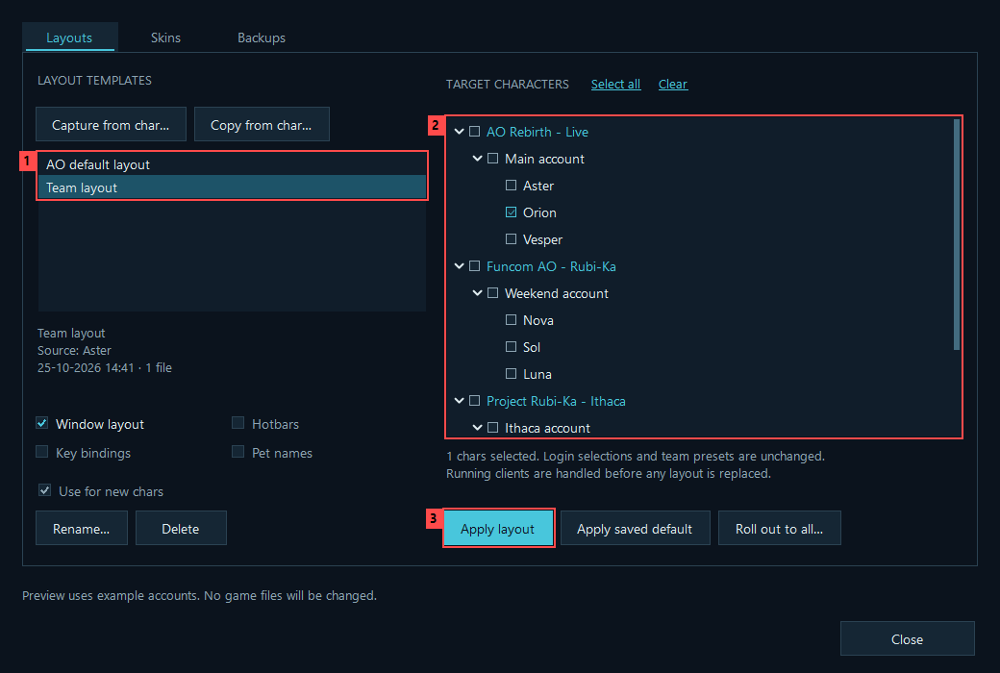
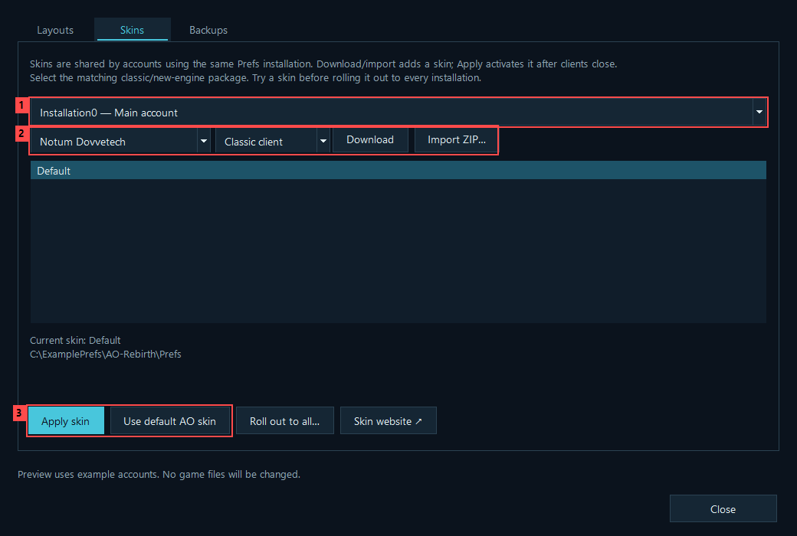
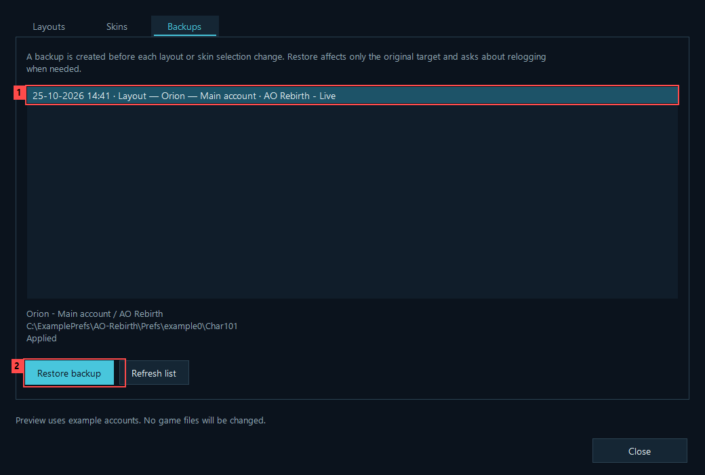

# Game GUI: character layouts and skins

[Player guide](Player-Guide.md) · [Download](https://github.com/RazRn/AO-Nexus/releases/latest)

Open **Game GUI · Experimental** in AO Nexus. Test changes on one character before a broad rollout. The manager separates three jobs into tabs:

- **Layouts** saves a character's setup as a reusable template and applies it to selected characters.
- **Skins** installs and selects the visual skin for a game installation's shared preferences.
- **Backups** restores an earlier character layout or skin selection.

These are different scopes. A window layout belongs to a character. The game's skin selector belongs to its shared installation preferences, so changing the skin affects every account using those preferences.

## Create and use a layout

1. Arrange the GUI on a character in game.
2. Open **Game GUI → Layouts → Capture from char…**. Pick that source character, give the template a name and choose its components.
3. The confirmation identifies the source character. If it is online, Nexus requests `/quit` and waits for actual exit before reading the newly saved preferences, then relogs it after success. If it is already closed, confirm that its latest layout changes were saved by a normal logout. Cancel and reopen/rearrange the character first if they were not saved.
4. Select target characters in the server/account tree. Select a saved template and choose **Apply layout**. **Roll out to all…** includes all configured target characters and still asks for confirmation.

For a one-time copy, select targets first and choose **Copy from char…**. The temporary captured template is removed afterward; the target backups remain available.



*1 — Choose a personal template or the built-in AO default layout. 2 — Select the target character; start with one. 3 — Apply the selected layout. These are example accounts; the red marks are guide annotations.*

### Components

| Choice | What it transfers | Important limit |
| --- | --- | --- |
| Window layout | Supported window geometry, visibility, docking, container-view settings and chat-window presentation. | It does not copy the entire character folder. Resolution or different GUI versions may still require adjustments. |
| Hotbars | Shortcut-bar slot assignments. | Item, nano, perk and action references may not be usable by another character or profession. Review the resulting bars in game. |
| Key bindings | The character's saved keybinding archive. | Replaces the selected keybinding component; enable only when wanted. |
| Pet names | The character's saved pet-name values. | Optional, because these are personal settings rather than window layout. |

Window layout is the normal starting point. The other components are explicit choices. You can apply only components actually included in a template. Account credentials, character identity, chat history, friends and ignored-player data, backpack contents and other unsupported preferences are not copied.

Templates are local snapshots, not live links: changing the source character afterward does not silently change an existing template. Capture a new template when you want a new reference setup. **Rename** changes its label; **Delete** removes the stored template without resetting characters already using its layout.

### Reset to the game's standard layout

The built-in **AO default layout** is always shown in the template list. Select it, choose target characters and press **Apply layout**. Nexus reads `cd_image/gui/Default/CharPrefs.xml` from each target's installation and clears supported saved position/docking overrides so the game can use its defaults. The normal logout, backup and relog flow applies. Missing or invalid default files block the operation.

This reset keeps hotbar actions/count, key bindings, pet names, chat subscriptions, backpack contents and the active skin. It resets supported presentation settings, not the whole character folder. With a custom skin the result still uses that skin; use **Skins → Use default AO skin** separately if desired. Reset is not a portable personal template and cannot be renamed, deleted or queued for new characters, which already start with their game's defaults.

**Apply saved default** refers to the personal template chosen below, not the built-in AO reset.

### Use a personal default for new characters

Choose **Use for new chars** on a template to make it the default for newly added characters. This does not immediately overwrite existing characters. **Apply saved default** explicitly applies it to selected existing characters.

A new character must first have a real, saved `Char<ID>` preferences folder. When it does not exist yet, Nexus queues the default until the game has created it and closed normally. Nexus applies the queued template before a later launch when the character is offline. It does not write preferences over a running game or invent a new character's saved state.

The team preset startup default is separate: that chooses which characters are selected in the launcher, whereas the GUI default chooses a layout template.

For ideas to try, see [five starter layout templates](Starter-GUI-Layouts.md). These are generated, community-inspired starting points, not exact copies of other players' setups. Match the intended resolution and check the result in game; Nexus does not automatically rearrange a captured layout for a different screen size.

## Skins

Choose a target installation in **Skins**. The list includes **Default**, which selects the original AO skin, plus detected complete custom skins.

For Notum Dovvetech:

1. Choose a theme and explicitly select **Classic client** or **New engine**.
2. Choose **Download**. Nexus retrieves the reviewed core, theme and, for the new engine, its additional patch from the author's published links.
3. Downloading installs a separate skin folder; it does not activate it. Choose the installed skin and **Apply skin** to activate it.
4. **Roll out to all…** copies that skin to the other configured installations and applies it after reviewing the affected clients.



*1 — Choose the installation whose shared skin will change. 2 — Import a complete skin or download a catalogue theme. 3 — Apply an installed skin, or return to the default AO skin. Download and Apply are separate actions.*

**Import ZIP…** accepts a complete local skin archive containing `Graphics.uvga` and `Graphics.uvgi`. Supported contents are XML, UVGA/UVGI graphics, PNG/JPEG images and text files. Executables and scripts are not installed. Importing an author's core-only patch is not the same as importing a complete skin.

The built-in catalogue contains:

- Notum Dovvetech
- Notum Dovvetech Dark
- Notum Dovvetech Edge
- Notum Darktech
- Notum Darktech Mini
- Notum Darktech Mini HUD
- Notum Darktech Glass

### Where skins are stored

For the supported modern AO preference layout, custom skins live beside `Prefs`:

```text
%LOCALAPPDATA%\Funcom\Anarchy Online\<installation group>\<installation>\
    Gui\Nexus_<skin>_<unique suffix>\
    Prefs\Prefs.xml
    Prefs\<account>\Char<ID>\
```

Nexus changes only the `GUIName` value in that installation's `Prefs/Prefs.xml` to select a skin. It does not replace the game's built-in `cd_image/gui/Default` directory. Imported/downloaded skins receive separate names, so existing skin folders are not overwritten. Repeating an identical import or rollout reuses verified matching contents instead of making duplicate folders. Copying between installations creates a separate destination copy; later edits to the source do not propagate automatically.

**Use default AO skin** reselects the game's original skin. It does not delete custom files or reset all per-character preferences. If you previously used ndGUI's compact raid elements, the author recommends resetting those elements through ndGUI's options. If necessary afterward, the documented in-game commands are `/setoption RaidConfig false` and `/setoption RaidBarConfig false`.

### Sources, attribution and compatibility

The catalogue is based on [Honorbound's Notum Dovvetech site](https://sites.google.com/site/notumdovvetech/), with original work credited to Kitao and Misat0. The site publishes core **4.3.4.8** (8 March 2019), themes **4.3.4.5**, and a separate **4.3.4.8 new-engine/DX9 patch**. Its compatibility announcement covers game version **18.8.36**. The [author's Funcom forum thread](https://forums.funcom.com/t/notum-dovvetech-gui-4-34/6549) explains the move to that backup site; the [older rubi-ka.net site](https://rubi-ka.net/ndgui/) still lists core 4.3.4.7.

The author instructs users to exit the game before skin changes and describes skin customization as shared across characters. New engine and classic variants are not interchangeable. Availability of a download is not proof that it supports every current Retail, Project Rubi-Ka or AO Rebirth client build. Start with one installation and verify the result in game before rolling it out widely.

Nexus does not redistribute these skin archives inside its executable or GitHub ZIP. Downloads come from the author's published Google Drive links when requested. Each reviewed package has a pinned SHA-256 hash; an unexpected change is rejected instead of silently installing different contents. These hashes identify the reviewed files; they are not publisher signatures. The optional downloaded `ndGUI_Config_Tool.cmd` is omitted and never executed.

## Online clients and relogging

For a layout change, Nexus checks the affected characters. For a skin change, it checks the whole affected installation. The confirmation lists the targets and any identified clients that need to relog. It asks for any required login passwords before logging clients out.

Nexus sends `/quit`, waits for actual process exit, rechecks that affected clients are closed, then performs the file operation. After a successful change it restarts the clients it closed, using the normal account/server login rules. It does not change your selected team preset or dashboard checkboxes to build the relog request.

There is no forced process termination. If `/quit` is interrupted by combat, movement or another in-game action, or the clients do not exit within the wait limit, the operation stops. Clients already closed may remain closed; you can launch them again normally. A client that Nexus cannot identify safely must be closed manually before its preferences can be changed.

Do not manually launch the affected game or edit its preference files during an operation. Cancellation before the write step leaves game files untouched. Once a file transaction begins, it finishes or attempts recovery before returning, rather than stopping between arbitrary writes.

## Backups and recovery



*1 — Select the recovery record and review its original character or installation. 2 — Restore backup returns that target to the recorded state; it does not copy the record to a different character.*

Layout templates and recovery records are stored locally under `%LOCALAPPDATA%\AONexus\GuiLayouts`. They may contain character labels, local paths and copied GUI settings, so review them before sharing. They are not uploaded by Nexus.

Every applied layout records the previous affected data. Restoring uses that record and preserves unrelated preferences where possible. If the same settings were independently changed afterward, a conflicting restore can be refused rather than overwriting unknown changes. Nexus retains the latest **10 completed layout backups per character**, including the current undo record and records from successful restore or rollback operations. Failed or incomplete recovery records are preserved outside that limit.

Skin changes save a snapshot and the previous `GUIName` selection with a SHA-256 integrity record. Skin restore checks that the backup belongs to the same preference installation and selects the earlier skin. It does not replace the current whole `Prefs.xml`, so later display or other settings are retained. Restoring also creates an undo backup. After a successful selection, Nexus keeps the latest **10 successful skin-selection backups per Prefs root**, including the new undo record. Cleanup only removes recognized, intact Nexus backup folders containing exactly the two expected files. Interrupted, corrupt, unrecognized or extra-content records are retained for recovery or manual inspection; backups for other installations are untouched.

A rollout touches multiple targets. If one fails, Nexus attempts to restore already changed targets in reverse order and reports any recovery failures. This is recovery across separate file operations, not a single atomic transaction across all installations. Review the reported result and available backups before retrying; do not assume rollback always succeeded. Downloads and import staging folders are cleaned after successful or failed installation. Installed custom skins are retained for reuse; successful selection backups follow the retention limit above.
