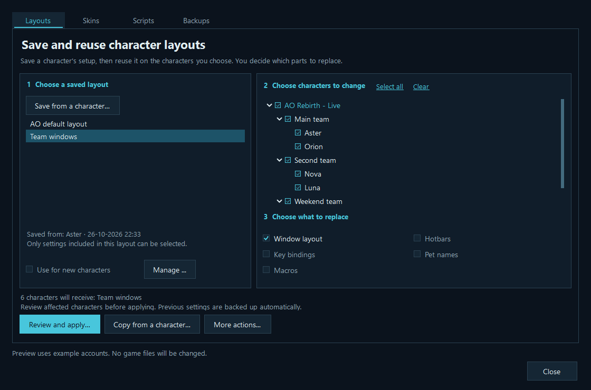
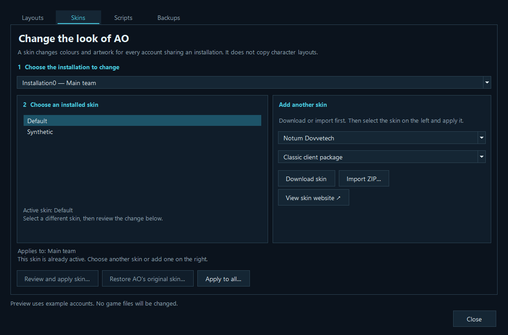
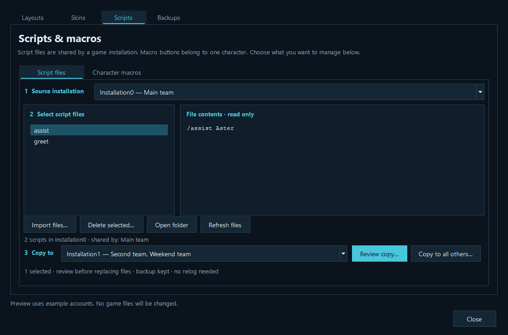
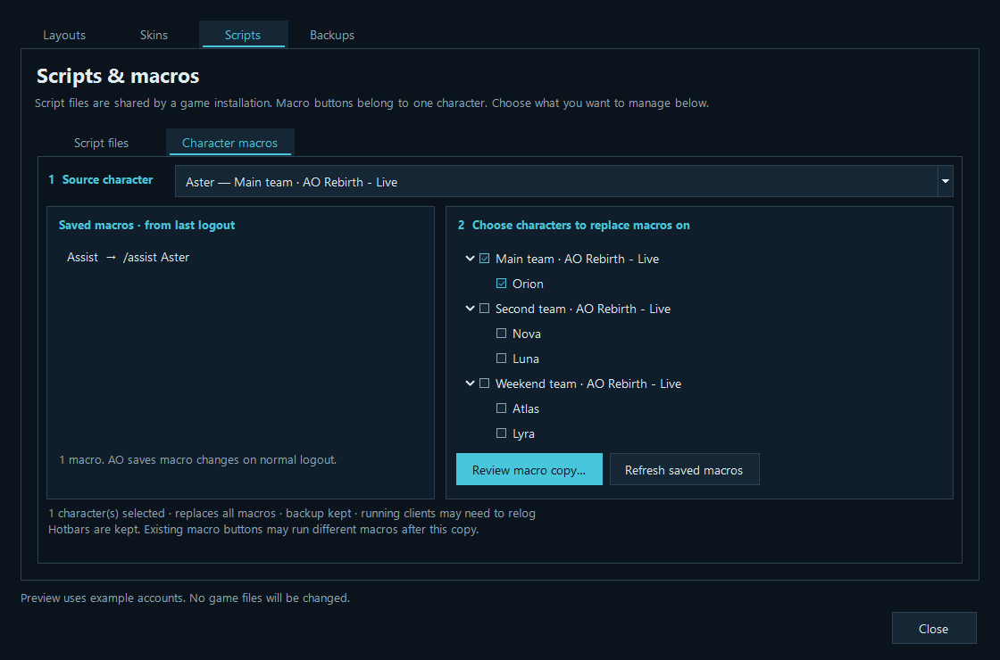
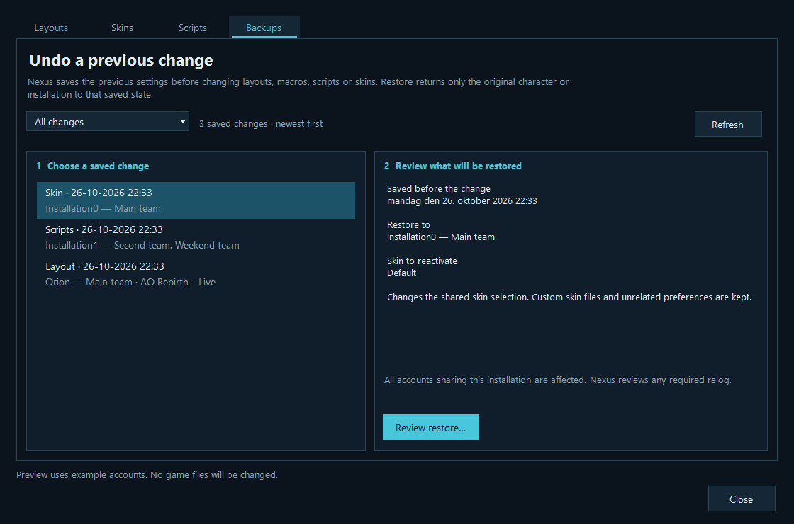

# Game GUI: character layouts, skins, scripts and macros

[Player guide](Player-Guide.md) · [Download](https://github.com/RazRn/AO-Nexus/releases/latest)

Open **Game GUI · Experimental** in AO Nexus. Each tab shows what you are changing, who it affects and the next step. Start with one character or installation before applying a change more widely.

- **Layouts** saves a character's setup as a reusable template and applies it to selected characters.
- **Skins** installs and selects the visual skin for a game installation's shared preferences.
- **Scripts** has separate **Script files** and **Character macros** views. Script files are shared by an installation; macros belong to a character.
- **Backups** restores an earlier character layout, macro, script or skin change.

These are different scopes. A window layout belongs to a character. The game's skin selector belongs to its shared installation preferences, so changing the skin affects every account using those preferences.

## Create and use a layout

1. Arrange the GUI on a character in game.
2. Open **Game GUI → Layouts → Save from a character…**. Pick that source character, give the saved layout a name and choose its components.
3. The confirmation identifies the source character. If it is online, Nexus requests `/quit` and waits for actual exit before reading the newly saved preferences, then relogs it after success. If it is already closed, confirm that its latest layout changes were saved by a normal logout. Cancel and reopen/rearrange the character first if they were not saved.
4. Under **1 Choose a saved layout**, select the layout you want to reuse.
5. Under **2 Choose characters to change**, tick the destination characters in the server/account tree.
6. Under **3 Choose what to replace**, choose the components to transfer. Read the selection summary, then choose **Review and apply…**. The next confirmation explains affected characters and any required relog before files change.

For a one-time copy, select destination characters first and choose **Copy from a character…**. Pick the source in the dialog. The temporary saved layout is removed afterward; the destination backups remain available. **More actions → Apply to all configured characters…** is the broader operation and still asks for confirmation.



*Choose a saved layout, select destination characters, then choose what to replace. The screenshots in this guide use synthetic example accounts.*

### Components

| Choice | What it transfers | Important limit |
| --- | --- | --- |
| Window layout | Supported window geometry, visibility, docking, container-view settings and chat-window presentation. | It does not copy the entire character folder. Resolution or different GUI versions may still require adjustments. |
| Hotbars | Shortcut-bar slot assignments. | Item, nano, perk and action references may not be usable by another character or profession. Review the resulting bars in game. |
| Key bindings | The character's saved keybinding archive. | Replaces the selected keybinding component; enable only when wanted. |
| Pet names | The character's saved pet-name values. | Optional, because these are personal settings rather than window layout. |
| Macros | The character's text macros (`TextMacro.bin`): every macro made with `/macro`, with its number. | Replaces all of the target's macros. Hotbars refer to macros by number, so ticking Hotbars also ticks Macros; untick it only if you know the targets' macro numbers match. |

Window layout is the normal starting point. The other components are explicit choices. You can apply only components actually included in a template. Account credentials, character identity, chat history, friends and ignored-player data, backpack contents and other unsupported preferences are not copied.

Saved layouts are local snapshots, not live links: changing the source character afterward does not silently change an existing saved layout. Use **Save from a character…** again when you want a new reference setup. **Manage → Rename…** changes its label; **Manage → Delete saved layout** removes the stored layout without resetting characters already using it.

### Reset to the game's standard layout

The built-in **AO default layout** is always shown in the saved-layout list. Select it, choose destination characters and press **Review and apply…**. Nexus reads `cd_image/gui/Default/CharPrefs.xml` from each destination's installation and clears supported saved position/docking overrides so the game can use its defaults. The normal logout, backup and relog flow applies. Missing or invalid default files block the operation.

This reset keeps hotbar actions/count, key bindings, pet names, chat subscriptions, backpack contents and the active skin. It resets supported presentation settings, not the whole character folder. With a custom skin the result still uses that skin; use **Skins → Restore AO's original skin…** separately if desired. Reset is not a portable personal template and cannot be renamed, deleted or queued for new characters, which already start with their game's defaults.

**More actions → Apply saved default to selected characters…** refers to the personal layout chosen below, not the built-in AO reset.

### Use a personal default for new characters

Choose **Use for new characters** on a personal saved layout to make it the default for newly added characters. This does not immediately overwrite existing characters. To apply it to existing characters, select them and use **More actions → Apply saved default to selected characters…**.

A new character must first have a real, saved `Char<ID>` preferences folder. When it does not exist yet, Nexus queues the default until the game has created it and closed normally. Nexus applies the queued template before a later launch when the character is offline. It does not write preferences over a running game or invent a new character's saved state.

The team preset startup default is separate: that chooses which characters are selected in the launcher, whereas the GUI default chooses a layout template.

For ideas to try, see [five starter layout templates](Starter-GUI-Layouts.md). These are generated, community-inspired starting points, not exact copies of other players' setups. Match the intended resolution and check the result in game; Nexus does not automatically rearrange a captured layout for a different screen size.

## Skins

Start at **1 Choose the installation to change**, at the top of **Skins**. The selector identifies the accounts sharing that installation's preferences. It controls the installed-skin list, where downloads/imports are stored, and where a skin is applied. Under **2 Choose an installed skin**, the list includes **Default** plus detected complete custom skins. The summary below identifies the accounts affected by your choice.

For Notum Dovvetech:

1. In **Add another skin**, choose a theme and select **Classic client package** or **New engine package** to match your game client.
2. Choose **Download skin**. Nexus retrieves the reviewed core, theme and, for the new engine, its additional patch from the author's published links.
3. Downloading installs a separate skin folder; it does not activate it. Select the installed skin on the left, then choose **Review and apply skin…** to review activation.
4. **Apply to all installations…** copies that skin to the other configured installations and applies it after reviewing the affected clients.



*Choose the installation first. Adding a skin makes it available; the separate review action activates it.*

**Import ZIP…** accepts a complete local skin archive containing `Graphics.uvga` and `Graphics.uvgi`. Supported contents are XML, UVGA/UVGI graphics, PNG/JPEG images and text files. Executables and scripts are not installed. Importing an author's core-only patch is not the same as importing a complete skin.

The built-in catalogue contains:

- Notum Dovvetech
- Notum Dovvetech Dark
- Notum Dovvetech Edge
- Notum Darktech
- Notum Darktech Mini
- Notum Darktech Mini HUD
- Notum Darktech Glass

### Where skins are stored

For the supported modern AO preference layout, custom skins live beside `Prefs`:

```text
%LOCALAPPDATA%\Funcom\Anarchy Online\<installation group>\<installation>\
    Gui\Nexus_<skin>_<unique suffix>\
    Prefs\Prefs.xml
    Prefs\<account>\Char<ID>\
```

Nexus changes only the `GUIName` value in that installation's `Prefs/Prefs.xml` to select a skin. It does not replace the game's built-in `cd_image/gui/Default` directory. Imported/downloaded skins receive separate names, so existing skin folders are not overwritten. Repeating an identical import or rollout reuses verified matching contents instead of making duplicate folders. Copying between installations creates a separate destination copy; later edits to the source do not propagate automatically.

**Restore AO's original skin…** reselects the game's original skin. It does not delete custom files or reset all per-character preferences. If you previously used ndGUI's compact raid elements, the author recommends resetting those elements through ndGUI's options. If necessary afterward, the documented in-game commands are `/setoption RaidConfig false` and `/setoption RaidBarConfig false`.

### Sources, attribution and compatibility

The catalogue is based on [Honorbound's Notum Dovvetech site](https://sites.google.com/site/notumdovvetech/), with original work credited to Kitao and Misat0. The site publishes core **4.3.4.8** (8 March 2019), themes **4.3.4.5**, and a separate **4.3.4.8 new-engine/DX9 patch**. Its compatibility announcement covers game version **18.8.36**. The [author's Funcom forum thread](https://forums.funcom.com/t/notum-dovvetech-gui-4-34/6549) explains the move to that backup site; the [older rubi-ka.net site](https://rubi-ka.net/ndgui/) still lists core 4.3.4.7.

The author instructs users to exit the game before skin changes and describes skin customization as shared across characters. New engine and classic variants are not interchangeable. Availability of a download is not proof that it supports every current Retail, Project Rubi-Ka or AO Rebirth client build. Start with one installation and verify the result in game before rolling it out widely.

Nexus does not redistribute these skin archives inside its executable or GitHub ZIP. Downloads come from the author's published Google Drive links when requested. Each reviewed package has a pinned SHA-256 hash; an unexpected change is rejected instead of silently installing different contents. These hashes identify the reviewed files; they are not publisher signatures. The optional downloaded `ndGUI_Config_Tool.cmd` is omitted and never executed.

## Scripts and macros

**Scripts** are plain text files in the `scripts` folder next to an installation's `Prefs` folder, for example `%LOCALAPPDATA%\Funcom\Anarchy Online\<id>\AORebirth-Live\scripts`. You run one in game with `/name`. Like skins, scripts belong to the installation: every account and character using it shares them.

On **Game GUI → Scripts → Script files**:

1. Choose the **source installation** at the top.
2. Select script files in the list. Use Ctrl-click to select several. The read-only preview shows the selected file's contents.
3. Choose a different **destination installation** below the preview and select **Review copy…**. **Copy to all others…** sends the selected files to every other configured installation. Same-name scripts with different content are replaced after a confirmation; identical ones are skipped.

**Import files…** adds text files to the source installation currently shown, for example scripts shared by another player. **Delete selected…** removes the selected scripts from that installation. **Open folder** opens its scripts folder so you can edit files in a text editor.



*The upper selector is where files come from. The lower selector is where a copy goes. Import and Delete act on the upper installation.*

The game reads a script when you use it, so script changes need no relog and work in running clients. Only plain text files of up to 64 KB with simple names (letters, digits, `-`, `_` and `.`) are handled. Program files such as `.exe`, `.bat` or `.ps1`, binary files, subfolders and linked folders are refused. Every copy, import or delete is backed up first.

### Copy character macros

Open **Scripts → Character macros**. Choose the source character at the top to see its macros saved at the last logout. Tick destination characters in the tree on the right, then choose **Review macro copy…**. This view has its own destination selection: you do not need to select characters on the Layouts tab, and its selections are kept separate.



*The whole saved macro set is copied. Choosing a destination replaces all of that character's macros, with a backup first.*

Macros are copied as a whole file through the normal layout safety flow. The source is saved through a normal logout when needed, affected online clients are relogged, and destination backups are kept. Macro-only copying leaves hotbars unchanged; an existing hotbar button may therefore run a different macro afterward because hotbars refer to macros by number. To transfer hotbars and matching macros together, use **Layouts** and include both components.

Macros and scripts can contain character names, for example `/assist Name`. They stay on your PC: Nexus never adds them to diagnostics or problem reports.

## Online clients and relogging

For a layout change, Nexus checks the affected characters. For a skin change, it checks the whole affected installation. The confirmation lists the targets and any identified clients that need to relog. It asks for any required login passwords before logging clients out.

Nexus sends `/quit`, waits for actual process exit, rechecks that affected clients are closed, then performs the file operation. After a successful change it restarts the clients it closed, using the normal account/server login rules. It does not change your selected team preset or dashboard checkboxes to build the relog request.

There is no forced process termination. If `/quit` is interrupted by combat, movement or another in-game action, or the clients do not exit within the wait limit, the operation stops. Clients already closed may remain closed; you can launch them again normally. A client that Nexus cannot identify safely must be closed manually before its preferences can be changed.

Do not manually launch the affected game or edit its preference files during an operation. Cancellation before the write step leaves game files untouched. Once a file transaction begins, it finishes or attempts recovery before returning, rather than stopping between arbitrary writes.

## Backups and recovery

Backups appear automatically after changes; there is no manual backup step to complete first. Choose **All changes**, **Layouts & macros**, **Skins** or **Scripts** to narrow the history. Records show their type, date and original character or installation, newest first.

Select a record under **1 Choose a saved change**. Under **2 Review what will be restored**, read its status, original destination and affected settings or script filenames. Choose **Review restore…** to review the operation before restoring. Restore always uses the original character or installation; it does not copy a backup to another destination. **Refresh** reloads the history, and an empty-filter message explains when to switch back to All changes.



*Review the recorded destination and settings before restoring. Incomplete changes and recovery-needed records are identified in the details.*

Layout templates and recovery records are stored locally under `%LOCALAPPDATA%\AONexus\GuiLayouts`; script backups are in its `ScriptBackups` folder. They may contain character labels, local paths and copied GUI settings, so review them before sharing. They are not uploaded by Nexus.

Every applied layout records the previous affected data. Restoring uses that record and preserves unrelated preferences where possible. If the same settings were independently changed afterward, a conflicting restore can be refused rather than overwriting unknown changes. Nexus retains the latest **10 completed layout backups per character**, including the current undo record and records from successful restore or rollback operations. Failed or incomplete recovery records are preserved outside that limit.

Skin changes save a snapshot and the previous `GUIName` selection with a SHA-256 integrity record. Skin restore checks that the backup belongs to the same preference installation and selects the earlier skin. It does not replace the current whole `Prefs.xml`, so later display or other settings are retained. Restoring also creates an undo backup. After a successful selection, Nexus keeps the latest **10 successful skin-selection backups per Prefs root**, including the new undo record. Cleanup only removes recognized, intact Nexus backup folders containing exactly the two expected files. Interrupted, corrupt, unrecognized or extra-content records are retained for recovery or manual inspection; backups for other installations are untouched.

Script changes back up the previous version of every script they replace or delete. Restoring a script backup first backs up the current scripts, so a restore can itself be undone. Nexus keeps the latest **10 completed script backups per installation**.

A rollout touches multiple targets. If one fails, Nexus attempts to restore already changed targets in reverse order and reports any recovery failures. This is recovery across separate file operations, not a single atomic transaction across all installations. Review the reported result and available backups before retrying; do not assume rollback always succeeded. Downloads and import staging folders are cleaned after successful or failed installation. Installed custom skins are retained for reuse; successful selection backups follow the retention limit above.
