# AO Nexus 1.3.0 player guide

Set up your accounts once, choose the characters you want to play, and save reusable teams. This guide covers 1.3.0. Screenshots use example data. Check the Releases page for available downloads; the source branch may be newer than the published executable.

[Project overview and download](../../README.md) · [Game GUI guide](Game-GUI.md) · [Privacy and security](Privacy-and-Security.md)

## Contents

- [Install and first launch](#install-and-first-launch)
- [Accounts and characters](#accounts-and-characters)
- [Servers and limits](#servers-and-limits)
- [Team presets](#team-presets)
- [Launch, stop and logout](#launch-stop-and-logout)
- [Passwords](#passwords)
- [Server news and health](#server-news-and-health)
- [Character status and monitoring](#character-status-and-monitoring)
- [AO# plugins](#ao-plugins)
- [Control Panel](#control-panel)
- [Damage Dumper](#damage-dumper)
- [Timers](#timers)
- [Settings, tray and updates](#settings-tray-and-updates)
- [Activity log](#activity-log)
- [Layouts, skins and local data](#layouts-skins-and-local-data)
- [Report a problem](#report-a-problem)
- [Troubleshooting](#troubleshooting)

## Install and first launch

You need Windows 10/11, **.NET Framework 4.8 or 4.8.1**, and a separately installed AO game client prepared for your chosen server. Windows 10 version 1903 and later include Framework 4.8; Windows 11 includes 4.8 or 4.8.1. Older Windows 10 installations may need the runtime installed first. See [Microsoft's installation guide](https://learn.microsoft.com/en-us/dotnet/framework/install/on-windows-10).

The login engine and its runtime are bundled inside Nexus. Players do not need a .NET SDK or a separate launcher installation.

1. Open [published releases](https://github.com/RazRn/AO-Nexus/releases) and check the version. Download the packaged executable from the release assets.
2. Under **Assets**, download **AO-Nexus-Luckyspawn.zip**. The automatically generated **Source code** archives are for developers, not ready-to-run downloads.
3. Extract the whole ZIP to a folder you can write to, such as `%LOCALAPPDATA%\Programs\AO Nexus`. Avoid protected locations such as Program Files if you want Nexus to update itself without administrator access.
4. Open the extracted folder and run **AONexus.exe**. You can create a normal Windows shortcut to it.
5. On a fresh installation, complete the four-step setup: language, servers, app preferences, then review and optionally add accounts. No game is started by setup.

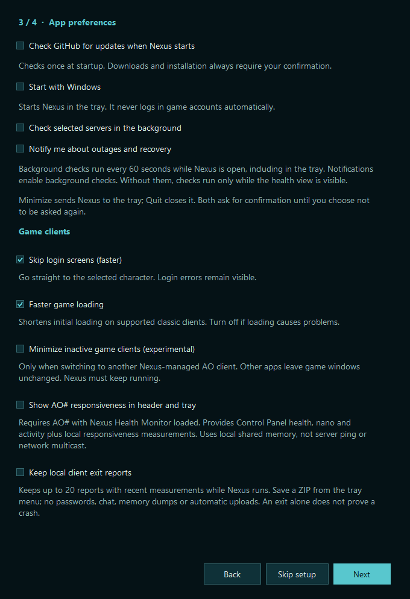


Select the servers you use to choose their news sources and health checks. These choices do not remove server presets or restrict account logins. Nothing connects to news, health services or GitHub until fresh setup finishes. **Skip setup** leaves those optional features off and does not keep changes staged in the wizard. You can enable them later in Settings.

The final step offers **Add first account…** or **Add another account…**. The account editor lets you choose its server/game folder, find Prefs, import character IDs and opt into remembering its password. Password entry waits until login. Accounts added here are saved with the other choices only when you press **Finish**.

Existing and imported profiles keep their configuration and are not forced through the wizard. To revisit it, use **Settings → General → Run setup again…**. Cancel discards wizard changes. Finish preserves existing accounts and team presets while saving your revised preferences.

The current executable is unsigned, so Windows may show an unfamiliar-app or SmartScreen warning. Confirm that you downloaded it from **RazRn/AO-Nexus** and verify the download before deciding whether to proceed. If you trust that download and your Windows policy permits it, the warning may offer **More info → Run anyway**. Do not disable Windows security protections to run it.

To verify the downloaded ZIP, compare its SHA-256 hash with the ZIP checksum published with that release. In PowerShell:

```powershell
Get-FileHash -Algorithm SHA256 -LiteralPath '.\AO-Nexus-Luckyspawn.zip'
```

The **SHA256SUMS.txt inside the ZIP** checks individual extracted files; it is not the checksum of the ZIP itself. A matching checksum verifies consistency with the published download, not an independent publisher signature.

Your settings are stored under `%LOCALAPPDATA%\AONexus`, separately from the executable. If Nexus finds a supported older AO Launcher profile on first launch, it can copy that profile; the old launcher and its original profile remain separate afterward.

## Accounts and characters

### Add an account

Choose **Add account** in **Accounts by server**. An account's **Display name** is your label in Nexus; **Login username** must be the actual username accepted by the game server.

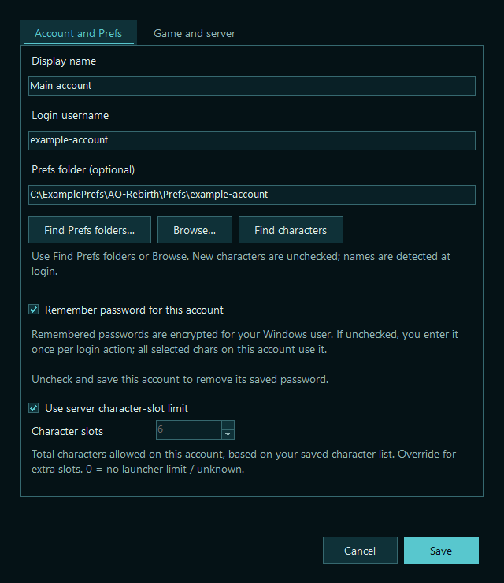


Open **Game and server**, choose the server preset, and select the game folder containing `AnarchyOnline.exe`. Each account keeps its own server and game-folder choice. Accounts can share an installation when that installation is compatible with their server.

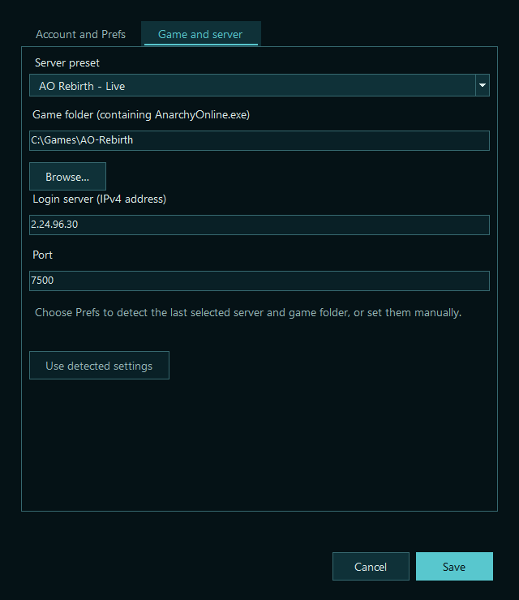


Save the account. Select it and use **Edit** whenever its name, game folder, server, password preference or character-slot setting changes. A missing game folder must be corrected before launch; if the game was removed, cancel and reinstall the appropriate client first.

### Import existing characters from Prefs

Prefs are optional local game settings. Importing them discovers saved character IDs; it does not fetch a character list from the game server.

1. In the account editor, choose **Find Prefs folders…**, **Browse…**, or paste a path.
2. Select the folder belonging to the correct account and game installation.
3. Choose **Find characters**, review the detected entries, and save the account.

The usual location begins at `%LOCALAPPDATA%\Funcom\Anarchy Online` and continues like this:

```text
<installation-hash>\<installation-name>\Prefs\<account-name>
```

The hash alone does not identify the server. Discovery uses available installation information to help you choose; still check the suggested game folder and server. You can also select a character's `Char123456` folder or the account's `Prefs.xml`. If a parent Prefs folder contains several accounts, choose the specific account folder or use the matching login username.

Imported characters start unchecked. **Character 123456 (name detected at login)** is a valid placeholder: Nexus learns the actual name when that character enters the game. You can edit its display name yourself.

### Add an existing character without Prefs

Save the account, select it, and choose **Add character**. Log into that character through the game normally and press **Shift+F9** to find its identity. For `50000:123456789`, enter **123456789** as the character ID. A display name cannot replace the ID.

Double-click a character to edit it. **Remove** deletes the selected launcher entry, not the character on the game server.

### Create a new game character

**+ Create new char** under an account opens the game's character-creation flow. It is different from **Add character**, which registers an existing ID in Nexus.

1. Double-click **+ Create new char**, or select it and use its action in Details.
2. Enter the account password if requested, then create the character in the game.
3. Keep Nexus running until the character enters the world. It watches that launched client for up to one hour and adds the detected ID and name.

New characters are unchecked and are not silently added to saved teams. The rest of Nexus remains usable during creation. Closing Nexus ends detection but leaves the game open; if detection ends before the character is found, import its Prefs or add its ID manually.

The creation row is hidden when the configured character-slot capacity has been reached. Nexus only knows about characters recorded in its profile; the game server makes the final decision about available slots.

## Servers and limits

Open **Settings → Login → Manage login servers…** to rename or add presets and change their addresses, ports or limits. Changes apply to accounts using that preset. Removing a preset leaves those accounts with their connection details as custom settings.

These are **bundled launcher defaults**, not a statement of current server policy. Existing profiles may retain their saved values. Review the server's own rules before changing limits.

| Server preset | Login endpoint | Max. accounts | Chars per account | Character slots |
| --- | --- | ---: | ---: | ---: |
| AO Rebirth - Live | `2.24.96.30:7500` | 0 | 0 | 6 |
| Funcom AO - Rubi-Ka | `37.18.192.41:7505` | 0 | 1 | 0 |
| Funcom AO - Rubi-Ka 2019 | `37.18.192.41:7506` | 0 | 1 | 0 |
| Project Rubi-Ka - Ithaca | `5.161.243.214:7000` | 2 | 1 | 0 |
| AO Rebirth — Local development (localhost) | `127.0.0.1:7500` | 0 | 0 | 0 |

**Local development** points to your own PC. It is not another public Rebirth server and requires you to run a compatible local server.

| Setting | What it means | Meaning of 0 |
| --- | --- | --- |
| Max. accounts | Accounts logged in at the same time on that server | No launcher account limit |
| Chars per account | Characters logged in at the same time on one account | No launcher character-login limit |
| Character slots | Total characters stored on an account; controls the creation entry | Unknown / no launcher capacity limit |

For example, an account may store six characters but allow only one online. A server row showing **1/∞ accounts selected** refers to selected accounts and the account limit, not character slots.

Accounts inherit their server's slot capacity. To override one account, edit it and clear **Use server character-slot limit**. Changing this value does not buy slots or change the server's rules.

Recognized clients already running count toward launch limits. The Funcom dimensions also share the per-account character restriction. Duplicate launcher entries do not bypass these checks.

## Team presets

The account tree groups **server → account → character**. Expand or collapse groups as needed; checking a parent selects its children. A team preset saves character selections across any of your accounts and servers.

Use **Search** above the account tree to find a name, character ID, account or server. Search is case-insensitive. Searching changes what is displayed, not the saved team or current selection. The selected count includes characters hidden by the search, and a separate count shows how many selected characters are hidden. With a search active, parent checkboxes and **Select matches / Clear matches** affect only matching characters. **Clear** or **Esc** restores the full roster and its previous collapsed groups.

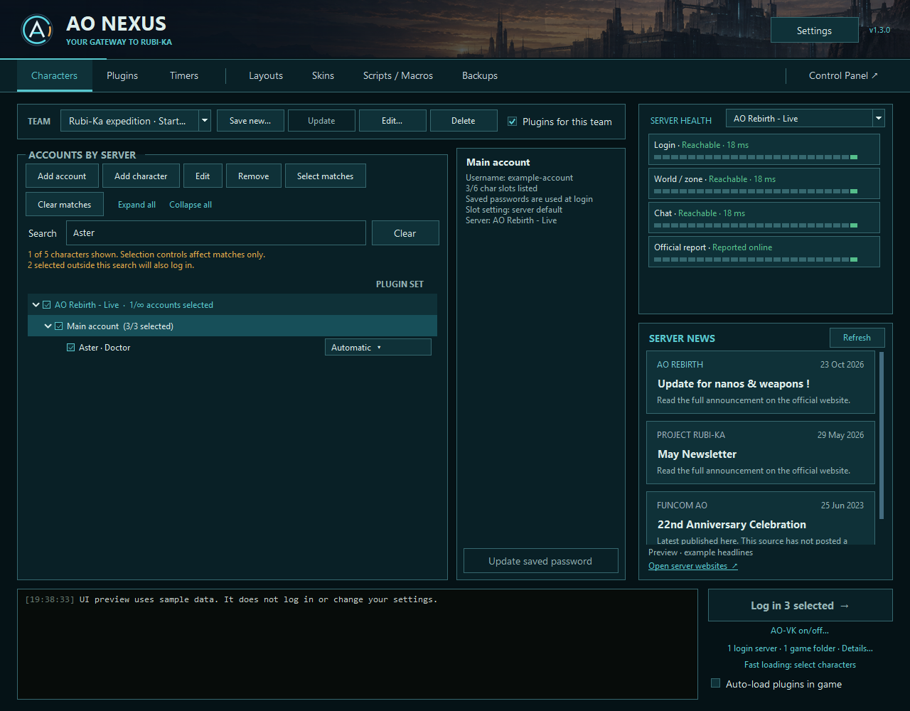

*The amber note shows that two selected characters are hidden by this search and will still log in. Clear the search to review the whole team.*

1. Check the characters you want in the team.
2. Choose **Team presets → Save new…** and give it a name.
3. Optionally choose a startup default and shortcuts, then **Save**.

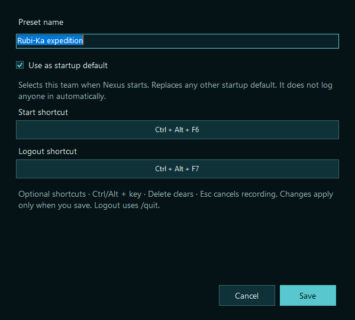


Selecting a preset restores its checkboxes; it does not launch games. After changing those checkboxes, choose **Update** to save the new membership. Update is enabled when the selection differs from the saved team. **Edit…** changes its name, shortcuts and startup-default choice. **Delete** removes only the preset.

There are two deliberately different “no preset” cases:

- Choosing **No preset selected** yourself clears the current character checkboxes. Saved teams remain intact.
- Starting Nexus with **no startup default** selects no preset but preserves your last manual character checkboxes.

Only one preset can be the startup default. It is selected when Nexus opens, without automatically logging in. Deleting it removes that default. Newly imported or created characters do not join existing teams automatically; missing members are reported and skipped.

### Choose shortcuts

In **Save new…** or **Edit…**, click a shortcut field and press a combination using Ctrl and/or Alt with a supported key, such as **Ctrl+Alt+F6** for start and **Ctrl+Alt+F7** for logout. **Delete/Backspace** clears it; **Esc** cancels recording. Save applies the change, while Cancel discards it. Reserved or conflicting combinations are rejected.

Shortcuts work while Nexus is running, including in the tray. Busy operations and modal editing dialogs block shortcut actions. The Start shortcut selects that saved team and starts its login flow; the Logout shortcut requests logout from safely matched clients. Each action shows its confirmation unless you have turned that confirmation off.

### Login order and initial leader

Edit the preset's character order before launching it. Put the intended leader first, followed by the Doctor, other support characters and remaining members as you prefer. Card order in the Control Panel is a separate display preference.

With automatic teams enabled, the first character is the initial leader and Nexus invites members as their clients become ready. The first client's focus can be retained while followers start in the background. Readiness and server response still determine when each login and invitation completes; a fixed team-loading time is not guaranteed.

## Launch, stop and logout

Choose **Log in selected**. When the confirmation is enabled, review the account/server/character counts and confirm. Nexus asks for passwords according to each account's preference.

Login and team logout each have a **Don't show this confirmation again** checkbox. The choice is saved only when you confirm; Cancel leaves it unchanged. Turn either confirmation back on independently in **Settings → General → Confirm before logging in / Confirm before team logout**, then choose **Save**. These choices also apply to team shortcuts. Skipping a confirmation keeps password prompts, account limits, game-folder checks and safe logout matching in place.

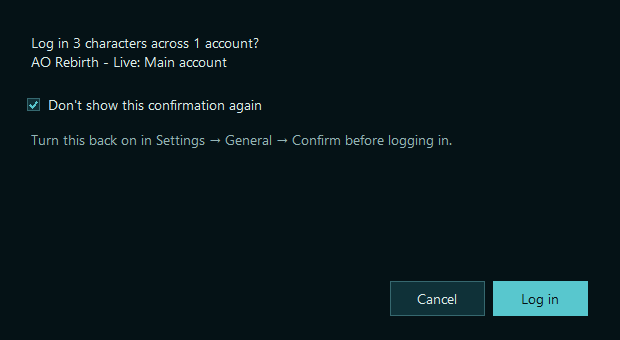

*Remembering the login choice does not disable the separate team logout confirmation.*

Independent accounts can start in parallel. Multiple characters on the **same account and server start serially**: the next waits until the previous character is detected in the world. Successfully started clients stay open. Public Nexus does not include experimental same-account parallel login.

By default the game client skips drawing the login and character screens and goes straight to the selected character, which is about 1.5 seconds faster per character. To see the game's own login screens (and any login error in the game window), turn off **Settings → Login → Skip login screens**. Clients started from the same game folder are kept at least 1.5 seconds apart, because AO briefly locks files in its folder while starting.

Recognized characters already open are skipped. If an account fails, its remaining queue stops while other account queues can continue. Check the log and game window rather than repeatedly starting the same failed selection.


*The red outline marks the header progress line. Confirmed logins or actual client exits advance it; moving activity shows waiting. It is not an estimate of seconds remaining.*

| Action | Result |
| --- | --- |
| **Stop login** | Stops further login activity. Already opened game clients remain open. |
| A team's **Logout shortcut** | Reviews matched clients when its confirmation is enabled, sends normal `/quit`, and waits for their exit. |
| **Close Nexus / Quit** | Exits the launcher, leaving game clients open. Shortcuts and monitoring stop. |
| **Minimize** | Keeps Nexus running in the tray, out of the taskbar and Alt+Tab. |

Logout uses the game's normal `/quit` countdown, not a forced process termination. Nexus watches for actual exit for up to 90 seconds. Combat, movement, zoning or cancelling logout can prevent it; clients are not forcibly closed.

Launch clients normally through the current Nexus version for logout control. A client opened for character creation needs a normal launch afterward before this control is available. AO# is not required.

## Passwords

Choose **Remember password for this account** independently for each account, in its editor or password prompt:

- **Unchecked:** enter the password once per account for each login/creation action. It can be reused for that action's characters, but is not saved for later actions.
- **Checked:** save the password encrypted for the current Windows user and use it for future logins.

New accounts start without password saving enabled; existing accounts retain their choice. One team can mix remembered passwords and accounts that prompt every time.

After changing a password **on the game server**, select the account in Nexus and choose **Update saved password** in Details. Enter the existing game password once and save. This replaces only Nexus's local copy and enables remembering it; it does not change or test the server password. Cancel keeps the previous copy.

To remove one saved password, edit that account, uncheck **Remember password**, and Save. **Settings → Login → Forget passwords** clears all saved copies immediately, without deleting accounts or teams. It does not wait for Settings to be saved and is not undone by Cancel. Remembering preferences remain, so a later prompt may save a new password.

Saved passwords use Windows user-bound encryption. They are not portable to another Windows user or PC. This local protection does not make the game's network login protocol encrypted; see [Privacy and security](Privacy-and-Security.md).

## Server news and health

Under **Settings → Sidebar**, enable **Server news**, **Server health**, or both, and choose which sources/servers you want. Both panels share tabs on the right; disabling both gives the account area more room.

News refreshes every 15 minutes while visible, or when you choose **Refresh**. Hiding the panel, switching to health, or minimizing pauses news refresh. Cached stories can remain available when fetching fails. Dates belong to the articles, not to the most recent check; an old headline does not necessarily mean refresh failed. Click a headline to open its source website.

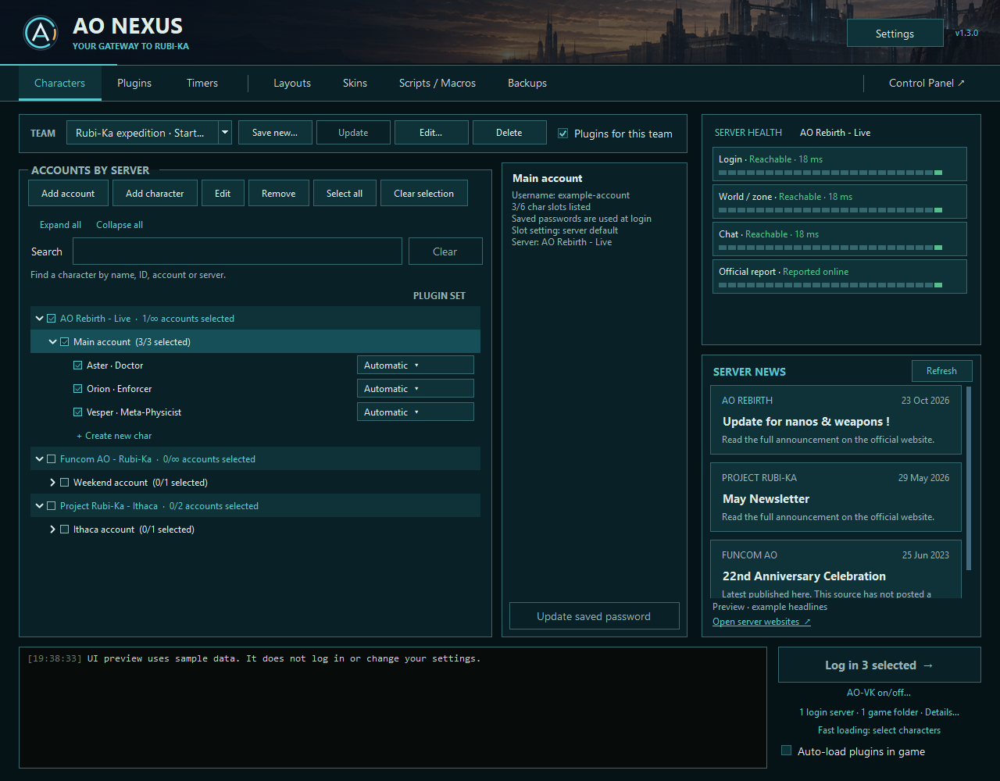


By default, health checks run every **60 seconds for the visible server**. Enable **Check selected servers in the background** to check selected servers while Nexus runs, including on the news tab or in the tray. The health panel has no manual Refresh button; if only one server is enabled, its name replaces the dropdown.

**Tray notifications for outages and recovery** also enables background checks. Two failed observations confirm an issue, typically within **1–2 minutes**, plus check duration. One positive observation confirms recovery. Windows controls popup duration; unresolved issues remain available through the tray's warning/status display while Nexus runs.

**Reachable** means a TCP connection succeeded from this PC, not that game authentication or zoning works. Local internet, DNS, routing or firewall problems can look like an outage. Official reports are separate; absent, stale or unverified information is **Unknown**, not proof of health. History bars show this session's observations, not continuous historical uptime.

Edit enabled checks, hostnames/IPs and ports under **Settings → Login → Manage health checks…**. Save that table and then Settings. Health endpoints do not change your account's login settings. Some servers have no verified zone/chat endpoint, so those checks remain disabled until configured. See [Server health](Server-Health.md) for exact defaults, timings and limitations.

## Character status and monitoring

Click the character status in the header or choose **Characters · status and help** from the tray menu. Select a character to see its status, a short explanation and the next useful step. **Show technical details** reveals the underlying measurements; **Monitoring setup help** opens the setup instructions and **Open measurement plugin folder** action. Both sections start collapsed.

**Responding**, **Delayed**, **No response**, **Measurement unavailable**, **Not measured**, **Monitoring stopped** and **Game closed** describe different situations. Missing measurements do not prove a crash, and **Game closed** can mean normal logout. These are local game measurements, not server ping.

**Recent action issue** is separate: a responsive character can still be unable to cast. The updated plugin flags nano casts attempted while falling, distinguishes observed attempts from confirmed game feedback, and groups repeated reports. Select the character for the next step. An alert fades after 30 seconds without a new report; this does not prove the cast succeeded. Other action failures are not yet covered. Reload the updated plugin from **Open measurement plugin folder** through AO# when safe; an already injected copy does not update automatically.

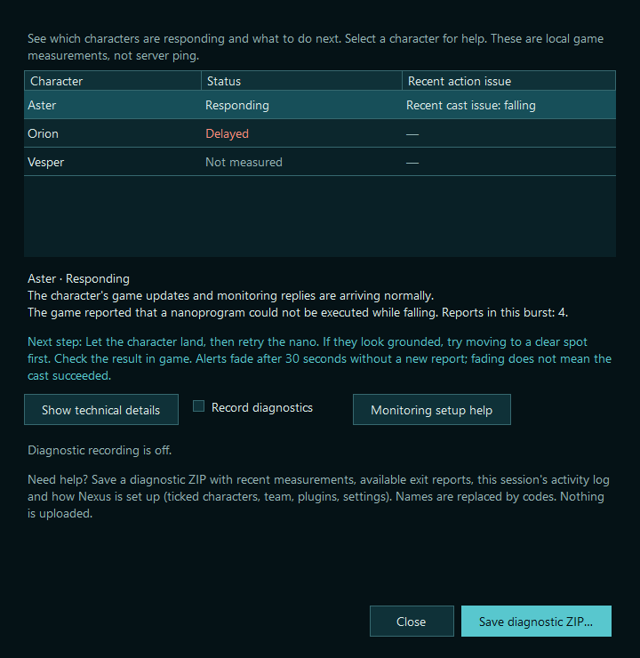

*Offline example: Aster is responding, but the game reported a cast blocked while falling. This does not identify a specific pet or prove that a retry succeeded. Exact live error-message coverage still needs verification.*

Monitoring is optional. Enable **Settings → Login → Show AO# responsiveness in header and tray**, then follow **Monitoring setup help** to enable Nexus Health Monitor in each relevant AO# profile. Keep Nexus running. **Keep local client exit reports** is a separate option; **Save diagnostic ZIP…** saves available evidence locally without uploading it. Read **report-summary.txt** first: it states whether plugin measurements are available. Reports retain recent samples and a summary of the time Nexus observed each client, including earlier peaks and gaps. A regular process sample or exit code zero does not prove the game was responsive. See [monitoring and exit reports](../development/log/Client-Monitoring.txt) for setup and measurement details.

## AO# plugins

Choose **Plugins** in the main window and select your own compatible AO# folder. Nexus does not supply AO# or third-party plugin bundles. Keep the game client's architecture and plugin dependencies compatible with that installation.

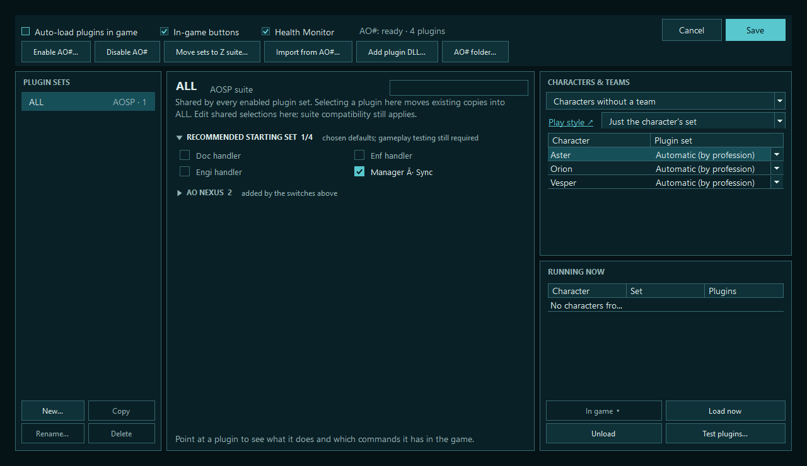

- **ALL** contains shared plugins for every profession, so you can add or remove common utilities once. Profession sets add their own choices.
- Assign a set to a character or saved team. Enable **Auto-load plugins in game** if you want them loaded during startup.
- **Health Monitor** supplies Control Panel measurements. **In-game buttons** supplies Nexus commands. A running helper is not upgraded by restarting Nexus; relog the client after updating helper code.
- **Missing** means a saved selection cannot be resolved in the currently selected installation. For example, Z-suite names do not become available by selecting a different pack. Choose installed alternatives or correct the folder; Nexus does not silently replace a handler.
- Review **Running now** and the activity log. A load request alone does not prove each plugin initialized successfully.

Use one profession handler at a time. Independent movement plugins can conflict with Nexus formations. Your existing plugin configuration is not reset by assigning a Nexus set.

## Control Panel

Open **Control Panel ↗** at the far right of the main navigation. It is a separate window. **Always on top** controls whether it stays above other windows; it can be turned off independently of the main app.

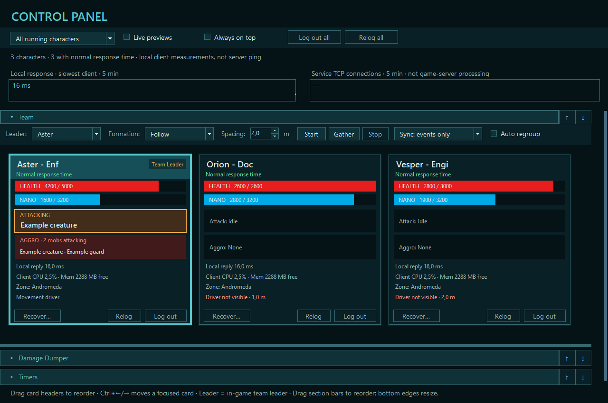

Click a character card to restore and view its game window. The border marks the selected/viewed client; selection does not change the card size. **Team Leader** identifies observed in-game leadership. Health is red and nano is blue, matching the game's bars.

**Attack: Idle** changes to the observed attack target while attacking. **Aggro: None** changes to a count and up to three observed mob names, with a remaining count for larger groups. This is nearby targeting evidence, not the server's complete threat list.

Normal, delayed and bad response-time states use green, yellow and red. Local reply measures the client helper, not server ping. CPU and free client address space describe the game process; zone and movement status help locate separated members. Missing or stale measurements are shown as unavailable.

Drag card headers to reorder them, or use their right-click ordering actions. Collapse **Team**, **Damage Dumper** or **Timers** to a bar and use their arrows to reorder the sections. The filter, preview toggle, always-on-top choice and layout preferences are remembered.

**Live previews** uses the window image available from Windows. **Minimized preview** means the actual game window is minimized, so the picture may freeze. Hover the card for the explanation. **Settings → Advanced → Minimize inactive game clients (experimental)** minimizes background clients to reduce resource use. Restore a client or turn that setting off to keep background windows restored; this can cost more CPU/GPU time. A paused picture alone does not mean telemetry or the game has stopped.

Use **Log out**, **Relog**, **Log out all** or **Relog all** for normal client shutdown/restart. Confirmations apply unless you disabled them. Active formation movement is stopped before a confirmed operation; cancelling leaves it alone. **Recover…** offers forced recovery for a client that cannot shut down normally. Forced recovery may lose unsaved game state.

### Formation and recovery experiments

Enable team automation in **Settings → Advanced** to expose its controls. Pick the **Leader**, formation and spacing/radius, then use **Start**, **Gather** or **Stop**. Choosing a different leader also requests the in-game leadership transfer; watch for confirmation rather than assuming the dropdown alone changed the team.

Follow follows the leader; Circle places followers around the leader; Funny business moves followers randomly within the radius and triggers emotes. Formation control temporarily owns follower movement; it must not compete with another movement controller. Stop releases that control. Zoning pauses the formation until fresh team state is available.

**Sync: events only** keeps event-based movement. **5 Hz trial** and **10 Hz trial** add periodic refreshes: more updates may reduce drift, but add processing and do not solve obstacles, zoning or stalled clients. Use the tooltip for the tradeoff. **Auto regroup** is separately opt-in and bounded; a blocked follower stops and attempts a Team location link. See [experiments and recovery limits](Experiments.md).

## Damage Dumper

Choose **Team** for your locally monitored characters, **All** for nearby observed players and their pets, or **NPC** for monsters' damage dealt and taken. All/NPC require the nearby-reports experiment and an updated observer. Player pets belong beneath their owners, not in the NPC table.

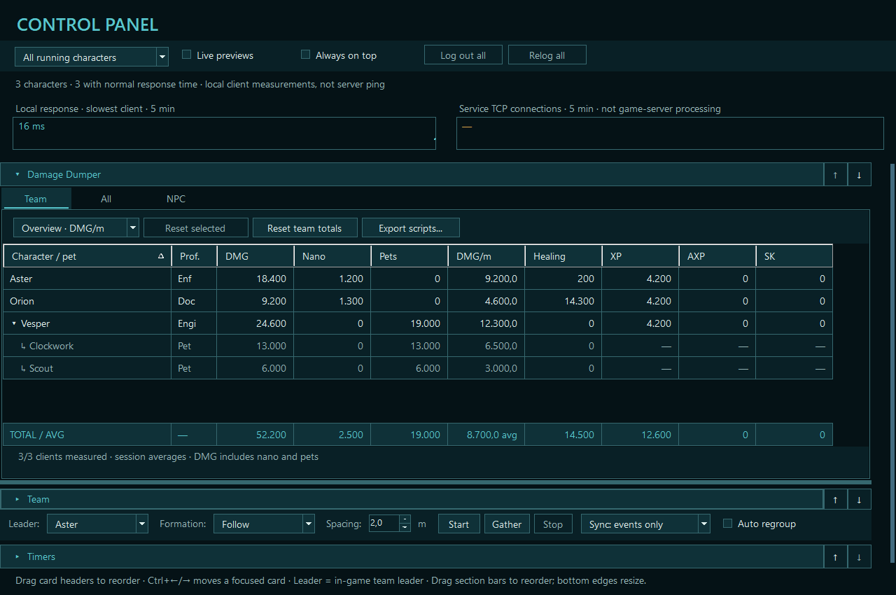

Click a heading to sort. The default overview uses **DMG/m**; other views show totals and rates per second, minute or hour. DMG includes nano and pet damage. Pet entries break down the owner's total and are not added twice. Names reflect observed pet names; respawns are grouped where identity/type evidence allows. Unknown professions or unavailable measurements remain blank rather than guessed.

Rates average over the recorded session or time since reset, including idle time; they are not a rolling last-minute total. The total line sums measured owners, while the rate marked **avg** averages their rates. **Reset selected** and the scope's total-reset button have separate effects. XP, AXP and SK require local measurements and are offered for Team, not inferred for strangers.

**Export scripts…** saves the current report snapshot into the chosen installation's scripts folder. In game, use **/nexus**, **/nexus-team**, **/nexus-all** or **/nexus-npc** to list reports. For example, **/nexus-team-dmg-preview** displays privately; **/nexus-team-dmg** posts in your currently selected chat channel. Recipients can open the coloured report pages without Nexus. Refresh and save again after a later fight. Exporting does not post anything automatically. [Commands and details](Combat-Scripts.txt).

## Timers

Use **Timers** in the main app or expand the Control Panel's Timers section. Choose the account/server scope, add a named timer, set its duration and optional advance warning, then save and start it when appropriate.

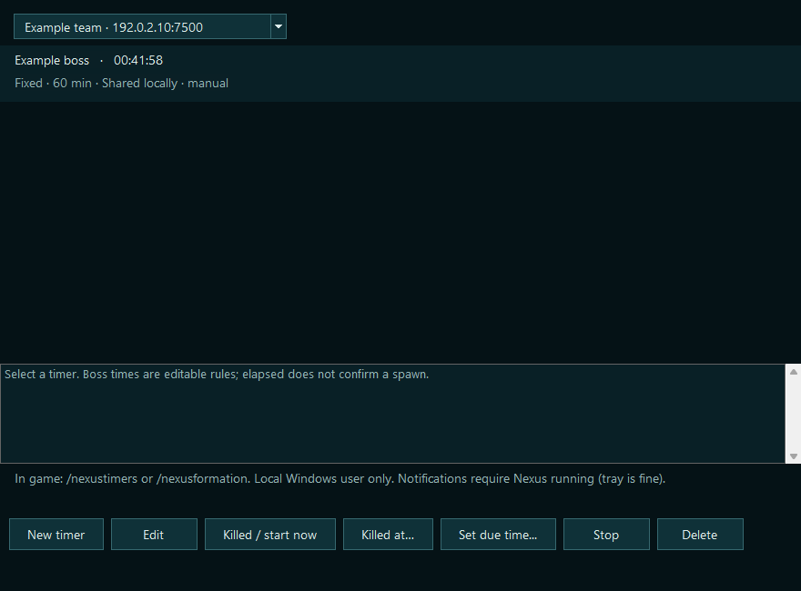

Fixed timers predict a due time; chance windows indicate a possible spawn window; personal timers can be tied to a character. Repeating reset timers use elapsed UTC time. **Observe death** requires a matching NPC name and a client that actually observes the event. A timer that says **Not started** has not begun counting down. No observation is proof that an unseen mob is dead, and a due timer is not confirmation of a spawn.

## Settings, tray and updates

**Settings → General** controls language, startup and confirmations. Automatic language chooses Danish for a Danish Windows locale and English otherwise. You can choose either manually. New log messages use the new language; existing messages are not rewritten.

Minimize and Quit have separate confirmation dialogs with **Don't show this again** choices. Re-enable them in Settings if needed. Click the tray icon to restore Nexus, or use its menu. Only one instance runs per Windows user session; opening another copy restores the existing one.

**Start with Windows** is optional and starts Nexus in the tray. It does not log game accounts in. If you move the app afterward, save Settings again to update the startup path.

### Recommended settings

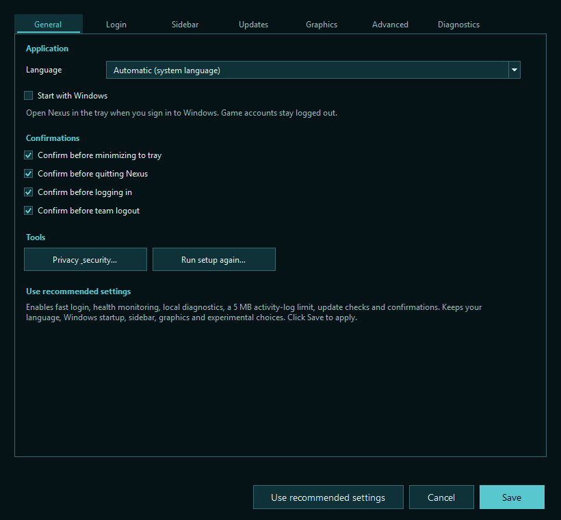

**Use recommended settings** stages fast/quiet startup, health monitoring, local diagnostics, a 5 MB activity-log limit, update/server-rule checks and confirmation dialogs. Review the tabs and choose **Save**; **Cancel** discards the draft.

It preserves your language, Windows startup, sidebar, graphics, auto-minimize and experimental choices. On a fresh profile, **Minimize inactive game clients** remains off. This optional setting can reduce background rendering load but may pause previews; it is not enabled silently by the recommended button.

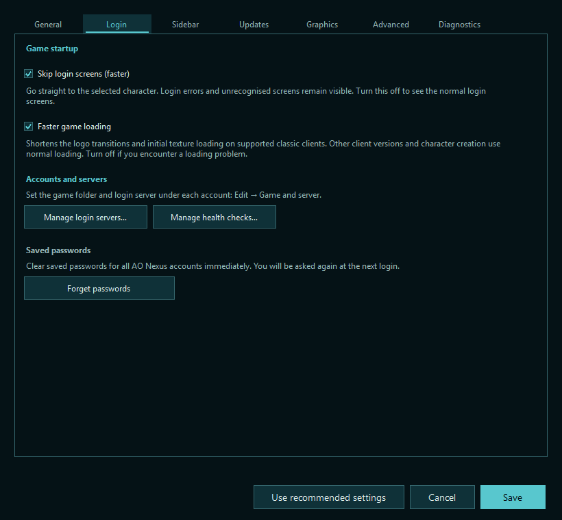

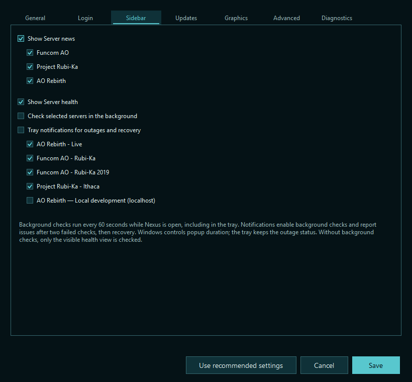

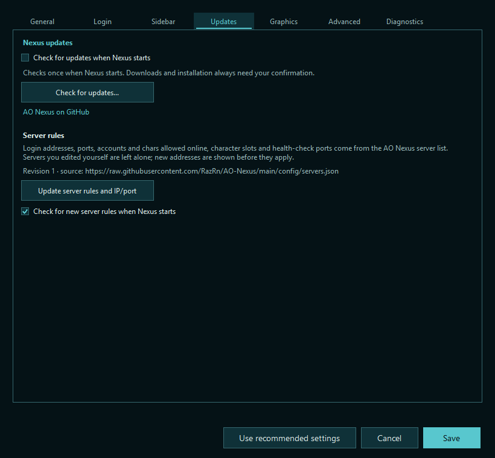

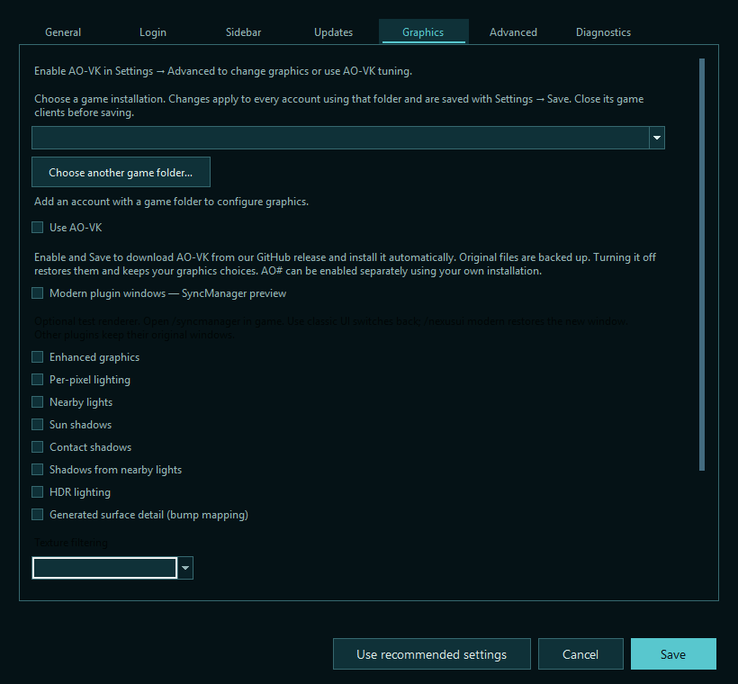

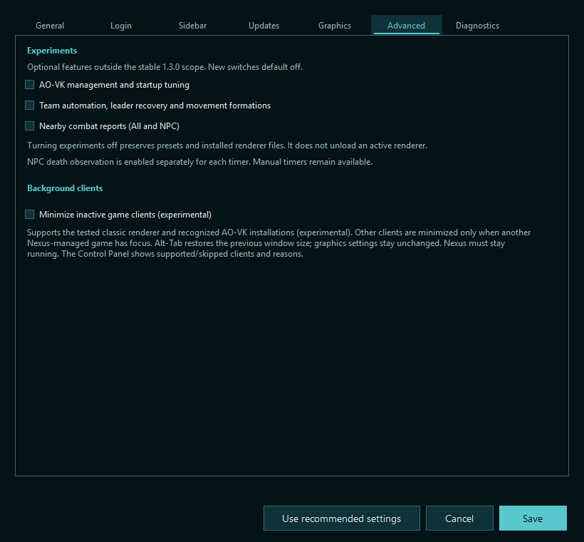

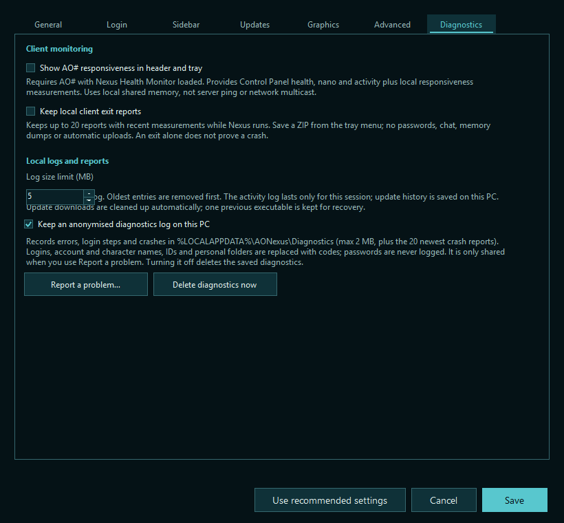

### Check and install an update

**Settings → Updates → Check for updates…** checks manually. If enabled, automatic checking happens **once when Nexus starts**, not repeatedly on a background timer. An available version also appears as a link in the header. Checks look for newer stable GitHub releases, not prereleases or downgrades.

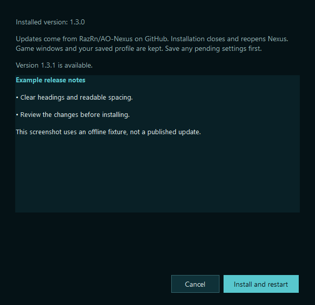


1. Save pending settings and finish or stop active launcher/Game GUI operations, including character-creation detection.
2. Review the release notes and choose **Install and restart**.
3. Nexus downloads and verifies the release, closes itself, replaces the executable, and restarts. Game windows and the saved profile are kept.

The updater checks the download against GitHub's SHA-256 metadata and validates the packaged executable/version. A failed download or integrity check leaves the installed version in place. These checks are not an independent publisher signature; the update source is still the project's GitHub release. The installation folder must be writable.

After a successful update, a one-time **What's new** window shows bundled notes. Normal subsequent starts do not repeat it. Update checks and installation results appear in the activity log; installation history is also saved under `%LOCALAPPDATA%\AONexus\Updates\update-history.log`.

Completed update staging is cleaned after restart. Abandoned staging older than 24 hours is eligible for cleanup; locked files are retried later. One previous executable is retained for recovery. Runtime folders that game clients may still be using are kept rather than deleted blindly.

For a manual update, close Nexus, extract the new release ZIP into its application folder, and reopen it. Your game clients can remain running. See [Privacy and security](Privacy-and-Security.md) for updater storage and retention details.

## Activity log

Click anywhere in the terminal-style log preview to open the resizable activity window. You can also focus the preview and press Enter or Space.

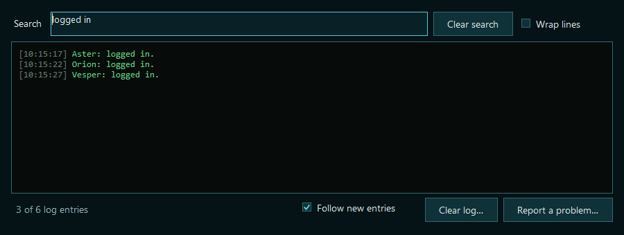


Search is literal and case-insensitive. **Ctrl+F** focuses it; clearing the search restores all retained lines. Turn off **Follow new entries** to read older entries without jumping to the latest output.

The activity log is held in memory. **Clear log** also clears the main-window preview, but does not delete the separate saved update history. New activity continues to appear afterward.

**Settings → Updates** sets a default **5 MB per-log text limit**, adjustable from 1–100 MB. Oldest text is trimmed as needed. This limits retained UTF-8 text, not the application's total memory usage. The activity log shows real account and character names; to share what happened, use **Report a problem…** in the activity window instead of copying the log.

## Layouts, skins and local data

Open **Game GUI · Experimental** for layouts, skins, scripts and recovery. Each view explains its scope and guides you toward a review step before changing existing settings:

- **Layouts:** choose a saved layout, choose destination characters, then choose which components to replace. **Save from a character…** adds a reusable layout; **Review and apply…** reviews the change. Personal defaults and applying to all characters are under **More actions**.
- **Skins:** choose the installation first, then an installed skin. Download/import adds a skin; **Review and apply skin…** activates it. Every account sharing that installation's preferences is affected.
- **Scripts → Script files:** choose a source installation, select files and read their contents, then choose another installation below and **Review copy…**. Import and Delete act on the source installation shown above.
- **Scripts → Character macros:** choose a source character and select destinations in this view's own tree. **Review macro copy…** copies the entire macro set with backups; it leaves hotbars unchanged.
- **Backups:** filter by change type, select a dated record, review its original destination and affected settings, then choose **Review restore…**. Restore acts on the original character or installation.

Use the [Game GUI guide](Game-GUI.md) before applying a layout: it explains saving source changes through logout, waiting for target clients to exit before writing Prefs, the difference between an AO default reset and your personal default, and recovery. Start with one character and keep backups.

Nexus stores accounts, paths, selections and teams in `%LOCALAPPDATA%\AONexus\AONexus.json`; these settings are not encrypted. Encrypted credentials, news cache, embedded runtimes, GUI templates/backups and updater data also live under that profile root. Moving the executable does not move the profile.

To back up your setup, close Nexus and privately copy its profile folder. Windows-bound passwords may not be recoverable on another account/PC. Do not share this personal folder or delete runtime files that running games may still need; share the public release ZIP instead.

Nexus has no analytics or automatic log uploads. It contacts your chosen game servers, enabled news/health sources, GitHub for requested update checks/downloads, and skin sources when you request them. See **Settings → General → Privacy & security…** or the [privacy guide](Privacy-and-Security.md) for destinations and storage details.

## Report a problem

When something does not work as expected — a character that never gets past the loading screen, a GUI change that fails, a crash — choose **Settings → Diagnostics → Report a problem…**, or **Report a problem…** at the bottom of the activity window.

1. Pick the **Area**, write a short summary and describe what you did, what you expected and what happened. Steps to reproduce help most.
2. Review the **preview**. It contains Nexus and Windows versions, a summary of your setup (counts, servers, game client versions and folder types), saved crash reports and the recent diagnostics log.
3. Choose **Open GitHub issue…**. Your browser opens a prefilled issue on `RazRn/AO-Nexus`; review it and choose **Submit new issue** (a free GitHub account is required). Long reports do not fit in a link: the full report is also copied to your clipboard, so paste it into the **Diagnostics** box. Without a GitHub account, use **Copy report** or **Save report…** and send it to the developer another way.

Nothing is sent until you submit it yourself. In the report, logins, account and character names, character IDs, team names, custom server addresses and personal folders are replaced with codes such as `Char-3fa2c1` or `GameFolder-8e01b4`. The same character always gets the same code on your PC, so a report still shows that, for example, the third character on one login timed out at the character-selection screen while the others entered the game. Passwords are never recorded. Messages printed by game clients can mention names Nexus does not know, such as other players — check the preview and remove anything you do not want to share.

If Nexus closes unexpectedly, it saves an anonymised crash report and offers to report it the next time it starts.

The diagnostics log is stored in `%LOCALAPPDATA%\AONexus\Diagnostics` (at most 2 MB, plus the 20 newest crash reports). Turn it off, or delete it immediately, under **Settings → Diagnostics**. See [Privacy and security](Privacy-and-Security.md#diagnostics-and-problem-reports).

## Troubleshooting

**Engineer standing-required spam after login:** this is a reproduced open issue, even when the model appears standing. Current automatic detection did not catch the reproduced case. Capture diagnostics and pause the offending auto-cast handler if it continues; do not treat the message as proof that the character is visually seated.


| Problem | What to check |
| --- | --- |
| Account has no characters | Prefs import is optional. Use Find characters, add an existing ID manually, or Create new char. |
| Several Prefs candidates | Match the account and installation; the hash directory alone is not a server name. |
| Placeholder character names | Verify the ID, then launch successfully once so Nexus can detect the name. |
| Game folder is missing | Select the correct folder containing `AnarchyOnline.exe`, or reinstall that server's game client. |
| Login queue stops | Read the activity log and game window. Check username, password, character ID and selected server. If it keeps happening, [report it](#report-a-problem): the report shows whether the client closed, timed out or never reached the character. |
| Password changed | Update the local saved copy after changing it on the game server. |
| Selection exceeds a limit | Distinguish simultaneous accounts/chars from stored character slots; already open clients count. |
| Create new char is absent/not detected | Check slot capacity; keep Nexus open through creation, or import the resulting Prefs/ID manually. |
| Changed team is not saved | Select that preset and choose Update when the button is enabled. Edit changes its properties. |
| News looks old | Compare the article publication date with the last refresh; the source may not have newer posts. |
| Health says unreachable | Check your own connection too. A local TCP failure does not prove a server-wide outage. |
| Executable cannot be replaced | Close Nexus, including its tray instance. Finish/cancel Game GUI operations first. |

Nexus expects compatible AO client/login behavior. Choosing a new endpoint alone cannot make an unrelated replacement client compatible.

To report a problem, use [Report a problem](#report-a-problem): it collects the version, Windows, setup and diagnostics for you, without account data. Screenshots help too; hide account and character names first. For source builds, see [Building and testing](../development/Building.md).
